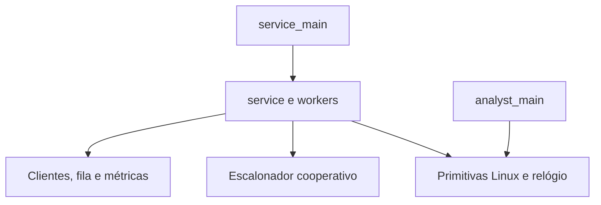

# Arquitetura da primeira parte do projeto

Este é o repositório de implementação do projeto. Nesta entrega existem somente documentos. A árvore de fontes descrita adiante é uma proposta para as próximas etapas, não um inventário de arquivos já implementados.

## 1. Fontes, escopo e classificação

As fontes foram consultadas no arquivo `sistemas-operacionais.zip`, recebido como contexto, sem modificar o ZIP nem o repositório de estudos que ele representa:

| Fonte dentro do ZIP | Uso |
|---|---|
| `sistemas-operacionais/CONTEXT.md` | Contexto da disciplina e finalidade do repositório de estudos. A identificação deste diretório como repositório do projeto foi esclarecida pelo usuário e prevalece sobre aquele contexto. |
| `sistemas-operacionais/work/descfinal.pdf`, página 1 | Requisitos e critérios de avaliação do trabalho 1. |
| Mesmo PDF, página 2, diagrama e notas | Protocolo entre processos, dados dos clientes, instante de chegada e limite da fila. Essa página contém informações visuais ausentes na extração textual. |
| Mesmo PDF, página 3 | Código de referência do cliente fornecido. |
| `sistemas-operacionais/work/about.md` | Anotações informais sobre as aulas; não ampliam automaticamente o escopo do trabalho 1. |
| `sistemas-operacionais/context/context.c` | Exemplo didático de troca de contexto; não deve ser copiado como solução pronta. |

Os requisitos essenciais estão transcritos de forma estruturada neste documento e no [AGENTS.md](../AGENTS.md), sem dependência de caminhos temporários da máquina. Os caminhos acima identificam a origem; não são arquivos existentes neste projeto.

Classificações adotadas:

- **R — requisito:** exigência do texto ou do anexo do professor.
- **P — protocolo:** comportamento do cliente de referência que a integração precisa preservar.
- **D — decisão:** escolha desta arquitetura, passível de revisão documentada sem violar R ou P.

O projeto é uma aplicação de espaço de usuário em Linux. Não será desenvolvido um kernel, shell, gerenciador de memória virtual ou componente da segunda parte. As notas gerais da disciplina não são autorização para antecipar essas funcionalidades.

## 2. Requisitos rastreáveis

| ID | Exigência | Origem |
|---|---|---|
| R01 | Usar Linux e C; não utilizar bibliotecas que implementem o paralelismo ou a comunicação entre processos pelo projeto. | PDF p. 1 |
| R02 | Ter pelo menos as threads Recepção e Atendente, criadas por troca de contexto, com escalonador próprio. | PDF p. 1 e diagrama |
| R03 | Receber N e X; criar N clientes quando N > 0 e gerar continuamente quando N = 0. | PDF p. 1 |
| R04 | A Recepção atribui prioridade alta ou baixa aleatoriamente, com 50% de probabilidade para cada uma. | PDF p. 1 |
| R05 | A paciência é X ms na prioridade baixa e X/2 ms na alta. | PDF p. 1 e nota 3 |
| R06 | A satisfação depende de conclusão menos chegada ser menor ou igual à paciência, incluindo espera e atendimento. | PDF p. 1 e nota 6 |
| R07 | No modo finito, concluir o atendimento de todos os N clientes e retornar satisfeitos/total. | PDF p. 1 |
| R08 | No modo infinito, parar por s e calcular satisfação somente entre os atendidos, ignorando os que ficaram esperando. | PDF p. 1 |
| R09 | Escrever o PID de cada cliente atendido em arquivo consumido por um processo Analista. | PDF p. 1 |
| R10 | Criar o Analista dormindo; a thread Atendente coordena seus despertares. | PDF p. 1 e diagrama |
| R11 | A cada despertar, imprimir no máximo os dez primeiros registros e apagar somente os impressos. | PDF p. 1 e diagrama |
| R12 | Antes de encerrar o modo infinito, despertar o Analista quantas vezes forem necessárias para esvaziar o arquivo. | PDF p. 1 |
| R13 | Manter PID, chegada, prioridade e demanda do cliente; chegada é o intervalo entre o início do programa e a criação do cliente. | Diagrama e nota 4 |
| R14 | Ler a demanda escrita pelo cliente antes de inseri-lo na fila; o arquivo compartilhado exige inserções serializadas. | Diagrama e nota 7 |
| R15 | No modo infinito, pausar a geração com 100 clientes em espera e retomar quando houver espaço. | Nota 9 do diagrama |
| R16 | Respeitar o protocolo de semáforo de atendimento, proteção do arquivo e identificação do Analista por arquivo de PID. | Diagrama e cliente p. 3 |
| R17 | Integrar o mesmo cliente fornecido pelo professor, sem alterar sua carga para obter vantagem. | PDF p. 1 e nota 5 |
| R18 | Apresentar o tempo total de execução. | PDF p. 1 e nota 8 |

A avaliação considera funcionamento, satisfação e tempo total. O enunciado permite trabalho individual ou em dupla. As regras de nota e a data de apresentação pertencem ao contexto de avaliação, não constituem funcionalidades a implementar. Nenhuma data histórica do PDF será tratada como prazo atual sem confirmação.

## 3. Decisões arquiteturais

| ID | Decisão e justificativa |
|---|---|
| D01 | C17 e Linux/glibc como alvo inicial; usar primitivas de sistema, sem frameworks ou dependências externas de execução. |
| D02 | Exatamente duas threads de usuário, cooperativas, executadas sobre uma única thread do kernel. Uma terceira thread só será considerada se surgir necessidade demonstrável. |
| D03 | Usar getcontext/makecontext/swapcontext isolados no runtime. O exemplo de aula usa essa família; ela não pertence ao POSIX atual e sua disponibilidade deve ser verificada no alvo. |
| D04 | Round-robin entre threads prontas; cada etapa de trabalho é limitada e termina em cessão, espera ou término. Não há preempção por timer. |
| D05 | EDF não preemptivo para clientes: menor prazo absoluto primeiro, com desempate pela sequência de criação. Isso é uma política permitida, não exigida pelo professor nem uma promessa de satisfação ótima. |
| D06 | Vetor com capacidade de 100 clientes esperando e seleção linear. Estender esse limite também ao modo finito limita recursos sem deixar de gerar N ao longo da execução. |
| D07 | No máximo um cliente em inicialização e um em atendimento. O primeiro preserva o arquivo de demanda; o segundo representa um único Atendente. |
| D08 | Em s, concluir o atendimento em andamento, cancelar os ainda não atendidos e drenar os registros. A satisfação inclui o atendimento em andamento se ele concluir normalmente. |
| D09 | Criar recursos por execução em run/<execution-id>/; permitir uma instância por vez, pois o cliente usa nome global fixo de semáforo. |
| D10 | Preservar demanda.txt como exceção de protocolo aprovada pelo usuário. Todos os nomes próprios novos serão em inglês. |
| D11 | Usar tempo monotônico em nanossegundos; medir a conclusão quando o término do filho for observado. |
| D12 | Despertar o Analista com dez registros, ao ficar sem clientes disponíveis com registros pendentes, ou durante a drenagem final. |
| D13 | N é inteiro não negativo e X é inteiro positivo em ms, ambos representáveis sem overflow nas operações necessárias. X = 0 será rejeitado como decisão de validação. |

## 4. Organização do projeto

Na árvore, `{c,h}` representa dois arquivos, um `.c` e um `.h`. Todos são futuros, exceto os três documentos desta entrega.

```text
.
├── AGENTS.md
├── README.md
├── Makefile
├── .gitignore
├── docs/
│   ├── architecture.md
│   ├── user-stories.md
│   └── verification.md
├── provided/
│   ├── README.md
│   └── client.c
├── src/
│   ├── service_main.c
│   ├── analyst_main.c
│   ├── domain/
│   │   ├── client.h
│   │   ├── client_queue.{c,h}
│   │   └── metrics.{c,h}
│   ├── app/
│   │   ├── service.{c,h}
│   │   └── workers.{c,h}
│   ├── runtime/
│   │   └── scheduler.{c,h}
│   └── platform/
│       ├── processes.{c,h}
│       ├── ipc.{c,h}
│       ├── completion_file.{c,h}
│       ├── terminal.{c,h}
│       └── clock.{c,h}
├── tests/
│   ├── domain_test.c
│   ├── scheduler_test.c
│   ├── integration_test.sh
│   └── fixtures/
│       └── controlled_client.c
├── build/
└── run/
```

`build/` e `run/` são gerados e ignorados pelo Git. Não criar diretórios vazios ou arquivos de implementação apenas para reproduzir a árvore.

### Documentação, construção e cliente

| Arquivo | Responsabilidade |
|---|---|
| AGENTS.md | Restrições e padrões para agentes que trabalham neste projeto. |
| README.md | Objetivo, ambiente, compilação, execução e interpretação do relatório. |
| Makefile | Construir service, analyst e client; disponibilizar verificações, modo de depuração e limpeza dos próprios artefatos. |
| .gitignore | Ignorar objetos, executáveis e dados locais de execução. |
| docs/architecture.md | Arquitetura, requisitos, contratos e decisões. |
| docs/user-stories.md | Backlog, critérios de aceitação, passos e rastreabilidade. |
| docs/verification.md | Comandos de verificação, resultados e procedimento de medição de desempenho. |
| provided/README.md | Origem e versão do cliente oficial, protocolo e unidades de tempo. |
| provided/client.c | Fonte oficial, preservada. O ZIP contém uma referência no PDF, não um arquivo cliente.c independente; obter/conferir a fonte oficial antes de declarar integração concluída. |

### Entradas e aplicação

| Arquivo | Responsabilidade |
|---|---|
| src/service_main.c | Converter e validar N/X, iniciar o serviço e apresentar o resultado final. |
| src/analyst_main.c | Preparar o Analista e executar seu ciclo de parada, lote e nova parada. |
| src/app/service.c | Possuir o estado da execução e coordenar recursos, eventos, despertares e finalização. |
| src/app/service.h | Expor configuração, resultado e entrada do serviço; declarar o contexto compartilhado necessário aos workers sem expor detalhes da fila ou dos contextos. |
| src/app/workers.c | Conter as rotinas Recepção e Atendente, seus passos e pontos de espera/cessão. |
| src/app/workers.h | Expor as duas rotinas de entrada; não publicar auxiliares internos. |

### Domínio e runtime

| Arquivo | Responsabilidade |
|---|---|
| src/domain/client.h | Definir o registro e os estados de um cliente. O PID pode usar pid_t, pois o alvo é explicitamente Linux; não se exige portabilidade fictícia. |
| src/domain/client_queue.c | Armazenar até 100 clientes e selecionar pelo prazo absoluto, sem executar processos. |
| src/domain/client_queue.h | Expor inserção, retirada do próximo, tamanho, capacidade e consulta de vazio. |
| src/domain/metrics.c | Calcular satisfação e acumular contadores sem consultar diretamente o relógio. |
| src/domain/metrics.h | Definir os contadores e as operações de registro e consulta. |
| src/runtime/scheduler.c | Possuir descritores de threads, contextos, pilhas, fila de prontas e condições de espera. |
| src/runtime/scheduler.h | Expor criar, ceder, esperar, despertar, executar e destruir o runtime. |

### Integração com Linux

| Arquivo | Responsabilidade |
|---|---|
| src/platform/processes.c | fork/exec, sinais, observação e recolhimento de filhos; encapsular também pselect e a máscara de sinais para aguardar eventos de filhos/entrada/interrupção. |
| src/platform/processes.h | Expor criação e controle de filhos e eventos tipados de parada, término, entrada disponível e interrupção. |
| src/platform/ipc.c | Criar e possuir semáforos e o bloqueio de instância; fechar e remover somente recursos próprios. |
| src/platform/ipc.h | Expor inicialização, tentativa de aquisição, liberação e fechamento. |
| src/platform/completion_file.c | Acrescentar registros, consumir os primeiros dez e compactar o restante sem reordenar. |
| src/platform/completion_file.h | Expor operações sobre o arquivo e resultados de lote, sem decidir quando despertar o Analista. |
| src/platform/terminal.c | Preparar entrada não bloqueante, permitir s sem Enter em TTY e restaurar flags e atributos originais. |
| src/platform/terminal.h | Expor preparação, descritor de entrada, leitura de comandos e restauração idempotente. |
| src/platform/clock.c | Obter CLOCK_MONOTONIC e converter unidades com verificação de overflow. |
| src/platform/clock.h | Definir a representação de instantes/durações e suas operações. |

### Testes

| Arquivo | Responsabilidade |
|---|---|
| tests/domain_test.c | Capacidade, seleção, desempates, paciência e métricas com instantes artificiais. |
| tests/scheduler_test.c | Alternância, espera, despertar, término e liberação segura de contextos. |
| tests/integration_test.sh | Executáveis, protocolos, limites, interrupção, falhas e resíduos do sistema. |
| tests/fixtures/controlled_client.c | Cliente exclusivo de testes, com tempos e falhas controláveis; nunca substitui o oficial na avaliação. |

## 5. Dependências e interfaces



- O domínio não faz I/O, não lê o relógio e não conhece o runtime.
- O runtime não conhece clientes, EDF, métricas, semáforos do protocolo ou arquivos de PIDs.
- A plataforma não escolhe clientes nem calcula satisfação.
- A aplicação traduz eventos da plataforma em mudanças de estado e despertares de threads.
- O runtime recebe uma função de processamento de eventos e seu contexto, fornecidos pela aplicação. Essa função consulta eventos entre despachos e pode aguardar quando não há threads prontas. Não é necessário um barramento genérico.
- Cabeçalhos expõem tipos e operações mínimos; helpers permanecem static na implementação. Evitar dependências circulares e acesso direto à representação privada de outro módulo.

### Dados e contratos principais

| Entidade/interface | Contrato |
|---|---|
| Configuração | N, X e caminhos internos resolvidos antes de mudar o diretório de trabalho. CLI pública: service N X. |
| Cliente | PID, sequência, prioridade, chegada, prazo absoluto, demanda, estado e conclusão quando disponível. |
| Fila | Guarda clientes prontos em espera; rejeita inserção cheia sem perder o registro; retirada transfere sua propriedade ao Atendente. |
| Métricas | Contadores de criados, concluídos, satisfeitos, cancelados e falhos; cada evento terminal é registrado uma única vez. |
| Espera do runtime | Identificador de condição, como espaço, cliente disponível, parada inicial, conclusão ou Analista parado. Verificar a condição antes de dormir e após despertar. |
| Eventos de processos | PID, tipo de mudança e status de término/parada. Um único consumidor coleta waitpid e distribui resultados. |
| Resultado final | Contadores, satisfação em proporção/percentual quando definida, tempo total e status de sucesso ou falha. |

As interfaces acima descrevem responsabilidades; assinaturas C serão definidas ao implementar a história correspondente, sem um framework de injeção de dependências.

## 6. Estados, execução e sincronização

### Escalonamento das threads

Estados: READY, RUNNING, WAITING e FINISHED. Cada thread tem pilha e contexto próprios. Há um contexto separado do escalonador; uma pilha nunca é liberada enquanto está em uso.

O round-robin considera apenas threads READY. As rotinas cedem após etapas limitadas. Fila, contadores e transições internas não contêm pontos de cessão no meio de atualizações. Como existe uma única thread de kernel e handlers não modificam essas estruturas, não há necessidade de mutex entre as duas threads de usuário.

### Eventos e esperas

- A aplicação observa eventos antes de despachar novamente uma thread, evitando que trabalho contínuo impeça leitura de s ou recolhimento de filhos.
- waitpid usa WNOHANG e WUNTRACED; esgotar todos os estados disponíveis, inclusive quando sinais se agrupam.
- Nunca interpretar SIGCHLD isoladamente como conclusão; distinguir parada inicial, término normal e falha por PID.
- Na ociosidade, pselect aguarda entrada e sinais. Bloquear os sinais pertinentes antes de verificar condições e usar a troca atômica de máscara durante a espera evita notificações perdidas.
- Handlers somente registram flags sig_atomic_t e preservam errno quando necessário. Não fazem printf, alocação, manipulação da fila ou troca de contexto.
- Não usar waitpid bloqueante, sem_wait ou sleep no caminho de espera de um worker. sem_trywait pode informar indisponibilidade; a thread só aguarda uma condição com evento de liberação definido.
- Restaurar máscaras, disposições pertinentes e descritores antes de exec do cliente. A aplicação é responsável por todos os filhos e por fechar descritores herdados desnecessários.

### Seleção dos clientes

Prazo absoluto = chegada + paciência. Menor prazo primeiro, desempate por sequência. Um vetor limitado a 100 elementos permite seleção O(100), suficientemente simples para a carga prevista.

O atendimento não é preemptivo. Não descartar clientes vencidos: no modo finito todos precisam ser atendidos; no infinito, apenas a parada interrompe o atendimento dos que ainda esperam. Alta prioridade não significa ultrapassar sempre toda prioridade baixa.

## 7. Fluxos principais

### Inicialização

1. Validar entradas e resolver caminhos dos executáveis sem depender do diretório de execução.
2. Iniciar a medição total, adquirir bloqueio de instância e criar diretório privado da execução.
3. Criar os semáforos previstos, inicialmente disponíveis, e o arquivo de concluídos vazio.
4. Criar o Analista; ele escreve analyst.pid e para com SIGSTOP. Observar essa parada antes de qualquer despertar.
5. Preparar entrada, eventos, runtime e as duas threads. Só então iniciar a geração.

O analista é filho direto do Atendimento; seu PID retornado por fork é a identidade de controle. O arquivo analyst.pid deve corresponder a ele, sem confiar em arquivos antigos.

### Recepção

1. Verificar parada, limite N e capacidade; aguardar espaço sem bloquear o Atendente.
2. Sortear prioridade com uma fonte pseudoaleatória inicializada uma vez no serviço. Cada sorteio tem probabilidade de 50%, sem forçar equilíbrio exato numa execução.
3. Registrar chegada imediatamente antes de fork, incrementar criados somente após criação bem-sucedida e iniciar o cliente no diretório da execução.
4. Aguardar sua parada inicial. Não criar outro cliente antes de ler e validar demanda.txt.
5. Registrar demanda, paciência e prazo; remover a demanda temporária já consumida e inserir o cliente na fila.
6. Notificar cliente disponível e ceder a execução.

Um cliente STARTING reserva uma vaga antes de sua criação. Não manter mais de 100 esperando nem criar um 101º enquanto a fila estiver cheia. Existe no máximo um STARTING; nenhuma outra criação pode sobrescrever sua demanda. A chegada inclui o custo de inicialização, não apenas o tempo após enfileirar.

### Atendente

1. Aguardar cliente disponível, retirar o escolhido e marcar IN_SERVICE, liberando capacidade da fila.
2. Enviar SIGCONT apenas depois da parada inicial confirmada.
3. Aguardar término normal do filho com status zero e capturar o instante observado, sem estimá-lo pela demanda declarada.
4. Registrar satisfação e conclusão uma única vez.
5. Acrescentar o PID ao arquivo, aguardando o Analista parar se ele estiver consumindo um lote.
6. Aplicar a política de despertar e iniciar a próxima etapa.

O semáforo /sem_atend existe para compatibilidade com o cliente. Sua disponibilidade não prova conclusão: após SIGCONT, o filho pode ainda não tê-lo adquirido. A evidência de conclusão é o status de término recolhido.

### Analista e arquivo de concluídos

completed.log contém um PID decimal por linha, na ordem de conclusão. A proteção corresponde ao sem_block do diagrama, usando /sem_block; /sem_atend preserva o nome do cliente de referência.

1. A thread Atendente pede o despertar; a aplicação só envia SIGCONT quando o Analista está comprovadamente parado e há registros.
2. O Analista adquire a proteção, imprime e confirma a escrita de até dez primeiros registros, compacta o restante e libera a proteção.
3. Volta a SIGSTOP. A observação dessa parada confirma o término do lote e permite outro despertar.

Enquanto o Analista está ativo, não acrescentar registros. Uma conclusão pode ficar pendente no Atendente até o retorno do Analista; não iniciar outro atendimento antes de persistir esse PID. A Recepção continua podendo avançar. Isso evita um protocolo adicional de confirmações por pipe ou memória compartilhada.

Um lote com falha de saída ou arquivo resulta em erro e encerramento; nunca confirmar drenagem por mera emissão de sinal. A ordem de remoção protege a execução normal, mas não há garantia transacional exatamente-uma-vez após crash entre impressão e compactação. Não tentar recuperação automática que possa duplicar saídas.

### Encerramento

Estados da execução: INITIALIZING → RUNNING → STOPPING → DRAINING → FINISHED. Falhas iniciam limpeza e encerram com status de erro.

- **Finito:** parar de criar após N; continuar até todos concluírem; drenar também o lote final antes de encerrar o Analista.
- **Infinito com s:** impedir novas criações e novos atendimentos; concluir o cliente já IN_SERVICE; cancelar os QUEUED e STARTING; registrar seu cancelamento e recolher seus processos. Um STARTING ainda não foi atendido e não precisa completar o protocolo para ser cancelado.
- Após isso, enquanto houver registros, despertar o Analista e aguardar confirmação de cada lote. Verificar o arquivo vazio antes de removê-lo ou concluir a execução.
- Encerrar o Analista parado com SIGTERM e SIGCONT, recolhendo-o. Clientes cancelados ainda não atendidos podem ser terminados com SIGKILL, inclusive quando parados, e sempre recolhidos.
- Liberar recursos na ordem inversa da aquisição, restaurar o terminal, finalizar a medição e imprimir o relatório. Limpeza deve aceitar inicialização parcial e repetição sem dupla liberação.

SIGINT/SIGTERM solicitam encerramento controlado, com diagnóstico de interrupção. No modo infinito, EOF sem s na entrada solicita encerramento com erro, evitando execução sem mecanismo de parada. Entrada redirecionada aceita s como byte; apenas TTY usa termios. No modo finito, EOF desativa o monitoramento da entrada.

## 8. Tempos, métricas e contrato do cliente

Guardar instantes e durações monotônicos em nanossegundos, convertendo X ms antes de calcular sua metade. Por exemplo, X = 5 ms produz paciência alta de 2,5 ms. Verificar overflow nas conversões e somas.

| Medida | Definição |
|---|---|
| Resposta | Conclusão observada menos chegada registrada. |
| Satisfeito | Resposta ≤ paciência, inclusive igualdade exata. |
| Taxa finita | Satisfeitos / N, apenas após conclusão bem-sucedida dos N. |
| Taxa infinita | Satisfeitos / concluídos; cancelados e ainda não atendidos não entram no denominador. |
| Nenhum concluído | Taxa não aplicável; mostrar concluídos = 0, sem dividir por zero. |
| Tempo total | Da inicialização antes de recursos/filhos até terminar drenagem e limpeza, imediatamente antes do relatório. |

A latência entre o término real do cliente e sua observação integra a medição. Não usar timestamp artificial inferido do tempo de serviço. Processar eventos com frequência reduz essa latência sem mascará-la.

Particularidades P do cliente de referência:

- **P01:** escreve demanda.txt antes de raise(SIGSTOP); somente depois deve ser enfileirado.
- **P02:** usa o semáforo nomeado /sem_atend após retomar; o serviço o prepara antes da criação.
- **P03:** a demanda é passada diretamente a usleep e está em microssegundos nessa versão, enquanto X está em milissegundos. Não multiplicar a carga nem alterar o fonte para aproximar unidades.
- **P04:** a geração interna de demanda usa srand/time; clientes próximos podem produzir demandas iguais. Não corrigir essa característica alterando o cliente oficial.
- **P05:** o cliente oficial ainda precisa ser conferido com a versão ilustrada no PDF. Divergências devem ser documentadas antes de alterar o adaptador.

## 9. Propriedade, falhas e limites

| Recurso | Proprietário e liberação |
|---|---|
| Estado da execução e registros de clientes | service; a fila possui os QUEUED, o Atendente o IN_SERVICE; liberar cada registro após registro terminal e coleta do filho. |
| Pilhas e descritores de threads | scheduler; destruir a partir do contexto do escalonador. |
| Processos filhos | Atendimento; processes concentra a coleta e não deixa workers competirem por waitpid. |
| Semáforos | Atendimento cria com identificação de propriedade e remove apenas os que criou; Analista e cliente usam os necessários. |
| Proteção de instância | Atendimento mantém um lock de arquivo no sistema durante toda a execução, por exemplo /tmp/service-simulator-<uid>.lock; não apagar o inode do lock enquanto outras instâncias puderem usá-lo. |
| Arquivos | A execução usa diretório próprio; Atendimento acrescenta PIDs e Analista remove registros impressos sob proteção. |
| Terminal e máscaras de sinais | Salvar antes de modificar e restaurar em todos os caminhos controlados. |

Falha de fork/exec, cliente com saída por sinal ou status diferente de zero, demanda inválida, erro de semáforo, Analista morto ou erro de arquivo/saída interrompem a execução normal. Emitir diagnóstico em stderr e limpar recursos; não ignorar clientes para alegar que N terminou. Resultado parcial deve ser identificado como tal e acompanhar status de erro.

Se um semáforo fixo já existir, falhar com diagnóstico; não apagar recursos de outra execução. SIGKILL ou queda do sistema podem deixar resíduos: não prometer limpeza nesses casos nem adicionar recuperação destrutiva automática. Nenhum requisito garante término de um cliente defeituoso; os testes de integração usarão um watchdog externo, sem alterar a satisfação ou inventar timeout de atendimento.

Guardar completed.log vazio ao término normal como evidência local é permitido; no erro, preservar pendências com diagnóstico. Arquivos temporários de demanda e analyst.pid devem ser limpos quando seguro. Todo run/ permanece ignorado pelo Git.

## 10. Verificação e desenvolvimento

As histórias, dependências, passos e matriz de cobertura estão em [user-stories.md](user-stories.md). A implementação seguirá domínio → runtime → processos/IPC → arquivo/Analista → integração → encerramento → entrega e medição. As primeiras quatro áreas podem ser verificadas isoladamente com dados e clientes controlados.

Verificações obrigatórias incluem N = 1, N > 100, N = 0, X ímpar, limites exatos de satisfação, fila cheia, demandas serializadas, lotes de 1/10/11/27, s em diferentes estados, erro parcial e ausência de filhos zumbis/sobreviventes após limpeza controlada.

Compilar com avisos fortes no código próprio. Usar ferramentas de memória quando compatíveis com ucontext, registrando suas limitações; ThreadSanitizer não é prova de correção de um runtime cooperativo baseado em contextos. Não alterar o cliente oficial para eliminar avisos do código fornecido.

Comparar desempenho com as mesmas condições e várias repetições. Cenários controlados servem à comparação reprodutível; execuções do cliente oficial servem à compatibilidade e avaliação real. Não prometer distribuição de demanda reproduzível alterando o código do professor.

## 11. Referências técnicas

As referências explicam mecanismos, sem acrescentar requisitos ao trabalho:

- [makecontext e swapcontext](https://man7.org/linux/man-pages/man3/swapcontext.3.html): contextos, pilhas e limites de portabilidade.
- [waitpid](https://man7.org/linux/man-pages/man2/waitpid.2.html): parada, término, WNOHANG, WUNTRACED e recolhimento.
- [Segurança em handlers](https://man7.org/linux/man-pages/man7/signal-safety.7.html): operações permitidas em contexto de sinal.
- [pselect](https://man7.org/linux/man-pages/man2/select.2.html): espera e troca atômica de máscara; o projeto monitora poucos descritores.
- [sem_wait e sem_trywait](https://man7.org/linux/man-pages/man3/sem_wait.3.html): distinção entre espera bloqueante e tentativa imediata.
- [clock_gettime](https://man7.org/linux/man-pages/man2/clock_gettime.2.html): relógio monotônico.

O texto geral proíbe bibliotecas auxiliares de IPC/paralelismo, enquanto o próprio anexo usa semáforos POSIX. A interpretação adotada permite essas primitivas explícitas e a libc, sem delegar o escalonamento a bibliotecas de threads. Uma orientação posterior do professor deve ser registrada e refletida nos três documentos antes de mudar essa interpretação.
