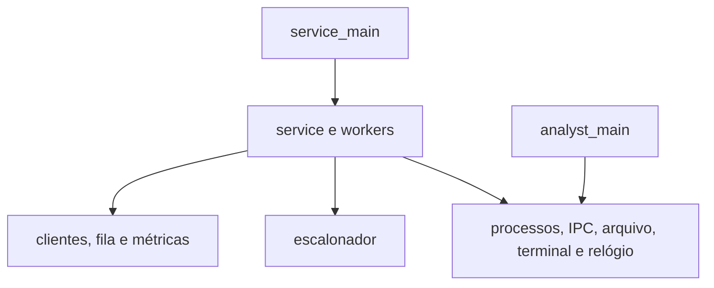

# Arquitetura do atendimento de clientes

Esta arquitetura cobre a primeira parte do trabalho prático. O registro do cliente e suas transições estão implementados na US01, com compilação mínima e testes de domínio. A estrutura abaixo descreve também os módulos ainda previstos. O [backlog](user-stories.md) organiza a entrega e o [AGENTS.md](../AGENTS.md) reúne as convenções de desenvolvimento.

## Fontes e alcance

Usamos três identificadores para evitar confundir o que foi pedido com o que foi escolhido aqui:

- **R:** requisito do trabalho.
- **P:** comportamento do cliente de referência que a integração precisa respeitar.
- **D:** decisão arquitetural do projeto. Uma revisão de D não pode contrariar R nem o contrato P.

O trabalho é uma aplicação de espaço de usuário em Linux. Shell, memória virtual, sistema de arquivos próprio e funcionalidades da segunda parte ficam fora desta implementação. A avaliação compara funcionamento, satisfação e tempo; regras de nota, possibilidade de dupla e data de apresentação pertencem ao contexto da disciplina, sem gerar funcionalidades do programa. A data impressa no PDF não é tratada como prazo atual.

## Requisitos do trabalho

| ID | Requisito | Fonte |
|---|---|---|
| R01 | Implementar em C no Linux, sem bibliotecas que façam o paralelismo ou a comunicação entre processos pelo projeto. | Texto, p. 1 |
| R02 | Criar pelo menos as threads Recepção e Atendente por troca de contexto e implementar o escalonador. | Texto, p. 1; diagrama |
| R03 | Receber N e X. N > 0 gera N clientes; N = 0 mantém a geração contínua. | Texto, p. 1 |
| R04 | Sortear a prioridade na Recepção, com probabilidade de 50% para cada classe. | Texto, p. 1 |
| R05 | Aplicar paciência X ms à prioridade baixa e X/2 ms à alta. | Texto, p. 1; nota 3 |
| R06 | Considerar satisfeito quem termina em até sua paciência, medida desde a chegada e incluindo espera e atendimento. | Texto, p. 1; nota 6 |
| R07 | No modo finito, atender todos os N e informar satisfeitos/total. | Texto, p. 1 |
| R08 | No modo infinito, encerrar por s e calcular a taxa apenas sobre clientes atendidos. | Texto, p. 1 |
| R09 | Gravar o PID atendido em arquivo para leitura pelo processo Analista. | Texto, p. 1 |
| R10 | Criar o Analista dormindo e despertá-lo sob coordenação do Atendente. | Texto, p. 1; diagrama |
| R11 | Por despertar, imprimir no máximo os dez primeiros PIDs e removê-los do arquivo. | Texto, p. 1; diagrama |
| R12 | Antes de encerrar o modo infinito, despertar o Analista até esvaziar o arquivo. | Texto, p. 1 |
| R13 | Guardar PID, chegada, prioridade e demanda. Chegada corresponde à criação do processo, medida desde o início do programa. | Diagrama; nota 4 |
| R14 | Ler a demanda escrita pelo cliente antes de enfileirá-lo e serializar criações que compartilham esse arquivo. | Diagrama; nota 7 |
| R15 | No modo infinito, pausar a geração com 100 clientes em espera e retomar quando houver vaga. | Nota 9 |
| R16 | Seguir o protocolo de semáforos do atendimento e do arquivo, além do arquivo de PID do Analista. | Diagrama; cliente p. 3 |
| R17 | Integrar o cliente fornecido, preservando sua carga e seu comportamento. | Texto, p. 1; nota 5 |
| R18 | Informar o tempo total da execução. | Texto, p. 1; nota 8 |

O PDF ilustra o cliente, mas o ZIP não contém um arquivo `client.c` independente. A fonte oficial precisa ser conferida antes de declarar a integração concluída.

## Decisões adotadas

| ID | Decisão | Motivo |
|---|---|---|
| D01 | C17 em Linux/glibc, sem dependências externas de execução. | Fixar o ambiente e manter o trabalho centrado nas primitivas do sistema. |
| D02 | Duas threads cooperativas sobre uma thread do kernel. | Atender o requisito sem introduzir outra linha de execução. |
| D03 | Isolar `getcontext`, `makecontext` e `swapcontext` no runtime. | Seguir a família usada em aula; verificar sua disponibilidade no alvo, pois ela não integra o POSIX atual. |
| D04 | Round-robin entre threads prontas, com cessão explícita em etapas curtas. | Evitar preempção por timer e troca de contexto dentro de handlers. |
| D05 | EDF não preemptivo para clientes, com desempate pela criação. | Selecionar o menor prazo absoluto sem interromper o atendimento iniciado. |
| D06 | Vetor de 100 vagas e busca linear; aplicar o limite também ao modo finito. | Conter recursos sem impedir que N clientes sejam gerados ao longo da execução. |
| D07 | No máximo um cliente em inicialização e um em atendimento. | Proteger a demanda compartilhada e representar o único Atendente. |
| D08 | Ao receber s, concluir o atendimento atual, cancelar os demais e drenar os PIDs. | Definir um encerramento verificável e o denominador da taxa. |
| D09 | Dados em `run/<execution-id>/` e somente uma instância ativa. | Isolar arquivos locais enquanto o cliente usa semáforo de nome global. |
| D11 | Tempo monotônico em nanossegundos; conclusão no instante observado pelo pai. | Preservar X/2 quando X for ímpar e evitar saltos do relógio civil. |
| D12 | Despertar o Analista com dez PIDs, na ociosidade com pendências ou na drenagem. | Escoar o arquivo sem exigir impressão após cada atendimento. |
| D13 | Aceitar N inteiro não negativo e X inteiro positivo em ms; rejeitar conversão com overflow. | Definir uma CLI sem cálculos inválidos; rejeitar X = 0 é decisão de validação. |

O limite de 100 no modo finito, EDF, C17 e a drenagem finita são decisões do projeto. O enunciado não exige essas escolhas específicas. EDF seleciona pelo prazo, mas não garante satisfação ótima em toda carga.

Toda implementação busca maximizar a taxa de satisfação e minimizar o tempo total de execução. Decisões de projeto podem ser revistas para esses objetivos, com atualização dos contratos e testes afetados, sem contrariar requisitos ou alterar o cliente oficial e as medições. Ganhos de desempenho exigem evidência em condições equivalentes; a US01 não altera a política de seleção.

## Estrutura prevista

```text
.
├── .github/pull_request_template.md
├── .gitignore
├── AGENTS.md
├── Makefile
├── README.md
├── docs/
│   ├── architecture.md
│   ├── user-stories.md
│   └── verification.md
├── provided/
│   ├── README.md
│   └── client.c
├── src/
│   ├── service_main.c
│   ├── analyst_main.c
│   ├── domain/
│   │   ├── client.{h,c}
│   │   ├── client_queue.{h,c}
│   │   └── metrics.{h,c}
│   ├── app/
│   │   ├── service.{h,c}
│   │   └── workers.{h,c}
│   ├── runtime/
│   │   └── scheduler.{h,c}
│   └── platform/
│       ├── processes.{h,c}
│       ├── ipc.{h,c}
│       ├── completion_file.{h,c}
│       ├── terminal.{h,c}
│       └── clock.{h,c}
├── tests/
│   ├── domain_test.c
│   ├── scheduler_test.c
│   ├── integration_test.sh
│   └── fixtures/controlled_client.c
├── build/
└── run/
```

Cada par `{h,c}` corresponde a dois arquivos: o `.h` define o contrato usado por outros módulos; o `.c` implementa as operações e mantém auxiliares privados. `build/` e `run/` serão gerados e ignorados pelo Git; a árvore não pede diretórios vazios agora.

| Arquivo | Responsabilidade |
|---|---|
| `.github/pull_request_template.md` | Estrutura para contexto, mudanças, verificação e pendências de um PR. |
| `.gitignore` | Excluir binários, objetos e dados locais de execução do versionamento. |
| `AGENTS.md` | Regras do projeto e convenções para desenvolvimento assistido. |
| `Makefile` | Construir `service`, `analyst` e `client`; oferecer alvos de teste, depuração e limpeza segura. |
| `README.md` | Apresentar o projeto, ambiente, execução e significado do relatório. |
| `docs/architecture.md` | Registrar requisitos, decisões, contratos e fluxos. |
| `docs/user-stories.md` | Organizar entregas, aceite, dependências e rastreabilidade. |
| `docs/verification.md` | Registrar comandos, resultados e condições de medição efetivamente usados. |
| `provided/README.md` | Registrar origem, versão e peculiaridades do cliente oficial. |
| `provided/client.c` | Preservar a fonte oficial quando recebida ou conferida; não usar a fixture de teste como substituta. |
| `src/service_main.c` | Validar `N` e `X`, iniciar o serviço e apresentar o relatório. |
| `src/analyst_main.c` | Executar a parada inicial e um lote por despertar do Analista. |
| `src/domain/client.h` / `.c` | Definir registro, unidades e transições verificadas do cliente, sem I/O ou processos. O uso de `pid_t` é compatível com o alvo Linux. |
| `src/domain/client_queue.h` / `.c` | Expor e implementar reserva, inserção, capacidade e seleção EDF da fila. |
| `src/domain/metrics.h` / `.c` | Expor e implementar contadores, satisfação e taxa com instantes fornecidos pela aplicação. |
| `src/app/service.h` / `.c` | Definir configuração/resultado e coordenar eventos, recursos, estado da execução e finalização. |
| `src/app/workers.h` / `.c` | Expor e implementar as rotinas Recepção e Atendente e seus pontos de espera. |
| `src/runtime/scheduler.h` / `.c` | Expor e implementar criação, despacho, cessão, espera, despertar e destruição dos contextos. |
| `src/platform/processes.h` / `.c` | Definir eventos e encapsular criação, sinais, `waitpid`, máscaras e `pselect`. |
| `src/platform/ipc.h` / `.c` | Definir e implementar propriedade, aquisição, liberação e limpeza de semáforos e bloqueio de instância. |
| `src/platform/completion_file.h` / `.c` | Definir formato/operações e implementar inclusão e consumo ordenado de até dez PIDs. |
| `src/platform/terminal.h` / `.c` | Definir e implementar leitura de s, entrada não bloqueante e restauração do terminal. |
| `src/platform/clock.h` / `.c` | Definir instantes/durações e implementar relógio monotônico e conversões verificadas. |
| `tests/domain_test.c` | Cobrir fila, prioridade, prazo e métricas com tempos artificiais. |
| `tests/scheduler_test.c` | Cobrir alternância, espera, despertar e liberação dos contextos. |
| `tests/integration_test.sh` | Exercitar os três executáveis, protocolos, limites, erros e encerramento. |
| `tests/fixtures/controlled_client.c` | Produzir demandas, tempos e falhas controladas somente nos testes. |

### Limites dos módulos



O domínio não faz I/O nem lê o relógio real. O runtime não conhece clientes, EDF ou o arquivo do Analista. A plataforma não decide a ordem dos clientes nem a satisfação. A aplicação liga esses módulos por interfaces pequenas e chamadas diretas; cabeçalhos não expõem a representação privada de outro módulo nem criam dependências circulares.

| Contrato | Dados e responsabilidade |
|---|---|
| Configuração | N, X e caminhos dos executáveis resolvidos antes de mudar o diretório de trabalho; CLI `service N X`. |
| Cliente | PID, sequência, prioridade, chegada, paciência, prazo absoluto, demanda, estado e conclusão quando houver. |
| Fila | Possui os clientes `QUEUED`; a retirada transfere o registro ao Atendente. Inserção cheia não descarta o cliente. |
| Métricas | Criados, concluídos, satisfeitos, cancelados e falhos; cada evento terminal atualiza contadores uma vez. |
| Runtime | Thread `READY`, `RUNNING`, `WAITING` ou `FINISHED`; condições de espaço, cliente, parada inicial, conclusão e Analista parado. |
| Processo filho | Evento com PID, tipo de mudança e status; um único consumidor recolhe os estados por `waitpid`. |
| Resultado | Contadores, taxa quando definida, tempo total e status de sucesso ou falha. |

O runtime recebe da aplicação uma função de processamento de eventos e seu contexto. Ela consulta eventos entre despachos e pode aguardar quando nenhuma thread está pronta. As assinaturas C serão definidas ao implementar cada módulo; não há necessidade de um barramento genérico.

### Registro do cliente — US01

`struct client_record`, em `domain/client.h`, é um registro por valor, sem alocação ou recurso próprio. PID usa `pid_t`; sequência, demanda e tempos usam `uint64_t`. Chegada, paciência, prazo absoluto e conclusão estão em nanossegundos; demanda está em microssegundos. A aplicação fornece chegada relativa ao início da execução no momento da criação; nenhuma transição a altera.

`client_init` exige PID positivo, prioridade válida e X positivo em milissegundos. Primeiro converte X para nanossegundos, depois divide por dois para prioridade alta e soma a chegada. Recusa conversão ou soma que ultrapasse `UINT64_MAX`, mantendo o destino intacto. O maior X aceito é `UINT64_MAX / 1000000` ms (18.446.744.073.709 ms); a chegada ainda precisa permitir a soma. Sequência zero é válida; unicidade e ordem são responsabilidade da aplicação.

| Operação | Transição | Contrato e propriedade |
|---|---|---|
| `client_init` | Armazenamento disponível → `STARTING` | Recepção possui o registro após a criação; não reinicializar um cliente ainda sob responsabilidade do serviço. |
| `client_enqueue` | `STARTING` → `QUEUED` | Recebe demanda já lida e validada pela plataforma; transfere o registro da Recepção para a fila. |
| `client_start` | `QUEUED` → `IN_SERVICE` | Retirada transfere o registro da fila ao Atendente. |
| `client_complete` | `IN_SERVICE` → `COMPLETED` | Recebe instante de conclusão maior ou igual à chegada, após confirmação externa de saída normal. |
| `client_cancel` | `STARTING` ou `QUEUED` → `CANCELLED` | Serviço assume cancelamento e recolhimento; atendimento em andamento deve terminar. |
| `client_fail` | Qualquer não terminal → `FAILED` | Serviço assume tratamento do erro e recolhimento. |

As operações retornam `bool`: ponteiro nulo, transição inválida ou instante de conclusão anterior à chegada são recusados sem alterar o registro. Estados terminais não permitem novas transições, inclusive repetição do mesmo evento. Esses contratos evitam registrar duas conclusões ou cancelamentos no mesmo registro; contabilização pertence à US03. A aplicação deve transferir a propriedade sem manter cópias ativas independentes.

A demanda só é válida após `client_enqueue`; zero e todo o intervalo de `uint64_t` são representáveis, sem converter unidades ou simular serviço. `completion_ns` só é válido em `COMPLETED`. Concluir após o prazo é permitido; satisfação será calculada nas métricas. As funções não enviam sinais, confirmam saída de processos nem liberam recursos: a aplicação só libera o registro após recolher o filho.

## Execução e sincronização

### Threads, fila e eventos

As duas threads de usuário têm pilhas e contextos próprios. O escalonador mantém um contexto separado, despacha as prontas em round-robin e só libera a pilha após sair dela. Cada worker faz uma etapa limitada, então cede, espera ou termina. Atualizações de fila, contadores e estados não cedem no meio da operação; como handlers também não modificam esses dados, não é necessário mutex entre as threads de usuário.

O Atendente seleciona o menor prazo absoluto (`chegada + paciência`); prazos iguais usam a sequência de criação. A busca linear percorre no máximo 100 registros. O atendimento já iniciado não é preemptado. Cliente vencido continua elegível: no finito todos os N devem ser atendidos; no infinito só a parada cancela os ainda não atendidos.

O componente de processos usa `waitpid` com `WNOHANG | WUNTRACED` e esgota os estados disponíveis. Um `SIGCHLD` indica que há trabalho a verificar, não a identidade nem a quantidade de eventos. Distinguir parada inicial, saída com status zero, saída com erro e término por sinal. A aplicação consulta esses eventos também quando há threads prontas, para que produção contínua não atrase a leitura de s ou a coleta de filhos.

Quando ambas esperam, `pselect` aguarda entrada e sinais. A máscara de sinais protege a passagem entre checagem da condição e espera, evitando notificações perdidas. Handlers somente registram flags `sig_atomic_t` e preservam `errno` quando necessário; não imprimem, alocam ou trocam contextos. Workers não usam `waitpid` bloqueante, `sem_wait`, `sleep` nem leitura bloqueante. Uma tentativa `sem_trywait` pode indicar indisponibilidade e levar a uma espera do runtime com evento de liberação definido. Antes de `exec`, o filho recebe máscaras, disposições e descritores adequados, sem herdar recursos desnecessários do pai.

### Inicialização

1. Validar N/X e resolver os caminhos dos executáveis.
2. Iniciar a medição; adquirir o bloqueio de instância e criar `run/<execution-id>/`.
3. Criar os semáforos inicialmente disponíveis e `completed.log` vazio.
4. Criar o Analista. Ele escreve `analyst.pid` e para com `SIGSTOP`; o pai observa essa parada antes de despertá-lo.
5. Preparar entrada, eventos e as duas threads; iniciar a geração.

O Analista é filho direto do Atendimento. O PID retornado por `fork` é a identidade de controle; o conteúdo de `analyst.pid` deve corresponder a ele, nunca a um arquivo antigo.

### Recepção

1. Verificar parada, limite N e espaço na fila. Sem espaço, esperar pelo runtime e manter o Atendente executável.
2. Sortear a prioridade com uma fonte inicializada uma vez no serviço. Cada cliente tem probabilidade de 50% por classe; uma amostra não precisa conter metade exata.
3. Reservar uma vaga para o cliente `STARTING`, registrar a chegada imediatamente antes de `fork` e iniciar o processo no diretório da execução. Contar o cliente como criado após o sucesso de `fork`.
4. Esperar a parada inicial, ler e validar `demanda.txt`, remover o arquivo consumido e completar demanda, paciência e prazo no registro.
5. Inserir o cliente `QUEUED`, avisar o Atendente e ceder. Criar o próximo somente após consumir a demanda anterior.

A reserva impede ultrapassar 100 clientes à espera mesmo com um `STARTING`. Um cliente `IN_SERVICE` não ocupa vaga. A medição desde a chegada inclui sua inicialização, e não começa apenas ao entrar na fila.

### Atendente

1. Esperar um cliente, retirá-lo por prazo e marcá-lo `IN_SERVICE`, liberando sua vaga.
2. Enviar `SIGCONT` somente após a parada inicial confirmada.
3. Esperar o término normal com status zero. O instante observado da conclusão é registrado antes do trabalho posterior de arquivo.
4. Atualizar satisfação e contadores uma vez; acrescentar o PID a `completed.log` e solicitar o despertar do Analista quando cabível.

Há um único cliente em atendimento. `/sem_atend` existe para o protocolo do cliente, mas sua disponibilidade não comprova término: após `SIGCONT`, o filho pode ainda não tê-lo adquirido. A confirmação vem do estado recolhido do processo.

### Analista e arquivo

`completed.log` contém um PID decimal por linha, na ordem das conclusões. `/sem_block` protege o arquivo e `/sem_atend` preserva o nome esperado pelo cliente ilustrado.

1. O Atendente solicita o despertar; o serviço envia `SIGCONT` somente se o Analista estiver comprovadamente parado e houver PIDs pendentes.
2. O Analista adquire a proteção, imprime e confirma a saída de até dez primeiros PIDs, remove esses registros, libera a proteção e volta a `SIGSTOP`.
3. O serviço observa a nova parada antes de autorizar outro lote. Desperta ao chegar a dez PIDs, durante ociosidade com pendências ou ao drenar o arquivo.

Não acrescentar PIDs enquanto o Analista consome um lote. Se um cliente terminar nesse intervalo, o Atendente guarda a conclusão pendente até a nova parada; a Recepção ainda pode progredir. Para 27 pendências, a drenagem precisa confirmar lotes de 10, 10 e 7 e verificar o arquivo vazio. Falha de saída ou arquivo encerra com erro; um sinal enviado não é confirmação de impressão. Não há recuperação transacional após crash entre impressão e compactação, que poderia duplicar uma saída.

### Encerramento

Estados da execução: `INITIALIZING`, `RUNNING`, `STOPPING`, `DRAINING` e `FINISHED`; falhas entram no caminho de limpeza com status de erro.

- **N > 0:** parar a geração após N, concluir todos, drenar também o último lote parcial e então encerrar o Analista.
- **N = 0, comando s:** parar criações e novos atendimentos, concluir o `IN_SERVICE` atual, cancelar `QUEUED` e `STARTING` e recolher esses filhos. Cancelados não entram no denominador da satisfação.
- **Drenagem:** despertar e esperar o Analista quantas vezes forem necessárias; confirmar cada parada e o arquivo vazio antes de finalizar.
- **Finalização:** encerrar o Analista parado com `SIGTERM` e `SIGCONT`, recolhê-lo, liberar recursos em ordem inversa, restaurar terminal e máscaras de sinais, encerrar a medição e emitir o relatório. Clientes ainda parados que foram cancelados podem receber `SIGKILL`, seguido de recolhimento.

`SIGINT` e `SIGTERM` solicitam limpeza controlada e diagnóstico. Em N = 0, EOF antes de s é erro para não deixar uma execução sem mecanismo de parada; no finito, EOF apenas desativa o monitoramento da entrada. Entrada redirecionada aceita o byte s; somente TTY exige alteração de `termios`.

## Tempo, métricas e cliente de referência

Guardar instantes monotônicos em nanossegundos. Converter X ms antes de dividir por dois, preservando, por exemplo, 2,5 ms quando X = 5. Verificar overflow em conversões e somas.

| Medida | Regra |
|---|---|
| Resposta | Conclusão observada menos chegada registrada. Inclui a latência de observação do pai; não é inferida da demanda. |
| Satisfação | Resposta menor ou igual à paciência, inclusive igualdade exata. |
| Taxa finita | Satisfeitos/N após sucesso com N concluídos. |
| Taxa infinita | Satisfeitos/concluídos; cancelar clientes não aumenta o denominador. |
| Zero concluídos | Taxa não aplicável, com contador zero; sem divisão por zero. |
| Tempo total | Da inicialização antes dos recursos/filhos até o fim da drenagem e limpeza, imediatamente antes do relatório. |

O cliente ilustrado no PDF determina estes pontos de integração:

| ID | Comportamento observado |
|---|---|
| P01 | Escreve `demanda.txt` e depois chama `raise(SIGSTOP)`. Ler a demanda somente após observar a parada. |
| P02 | Depois de `SIGCONT`, abre `/sem_atend` e usa o semáforo durante seu atendimento. |
| P03 | Passa a demanda diretamente a `usleep`, em **microssegundos**; X permanece em **milissegundos**. Não alterar unidades para aproximá-las. |
| P04 | Usa `srand(time(NULL))`; clientes próximos podem gerar demandas iguais. Não mudar a fonte oficial por esse motivo. |
| P05 | A versão do PDF é referência. Conferir o arquivo oficial, quando disponível, e documentar qualquer diferença antes de adaptar o serviço. |

## Propriedade dos recursos e falhas

| Recurso | Proprietário e liberação |
|---|---|
| Registros de clientes | `service`: Recepção cria, fila possui `QUEUED`, Atendente possui `IN_SERVICE`; liberar após o estado terminal e a coleta do filho. |
| Pilhas e contextos | `scheduler`; liberar a pilha somente a partir do contexto do escalonador. |
| Processos | Atendimento; `processes` concentra a coleta, inclusive de filhos cancelados ou parados. |
| Semáforos | Atendimento cria, fecha e remove somente os que possui; cliente e Analista acessam os previstos. |
| Bloqueio de instância | Atendimento mantém um lock durante toda a execução, por exemplo `/tmp/service-simulator-<uid>.lock`; não apagar seu inode enquanto outra instância puder usá-lo. |
| Arquivos da execução | Atendimento prepara e inclui PIDs; Analista consome o prefixo sob proteção. `run/` fica fora do Git. |
| Terminal e sinais | Salvar configuração antes de alterá-la e restaurar em todos os caminhos controlados. |

Erros de `fork`/`exec`, saída do cliente por sinal ou com status diferente de zero, demanda inválida, semáforo indisponível, morte do Analista ou falha de arquivo/saída encerram a execução com diagnóstico em `stderr` e status de erro. Não apresentar um finito incompleto como sucesso; identificar qualquer resultado parcial. A limpeza deve aceitar inicialização parcial e repetição sem dupla liberação.

Se um semáforo fixo já existir, falhar com diagnóstico em vez de remover um recurso alheio. `SIGKILL` ou queda do sistema podem deixar resíduos; não há limpeza garantida nesses casos nem recuperação automática destrutiva. Um cliente defeituoso pode não terminar: testes usam watchdog **externo**, sem introduzir timeout de atendimento no produto.

Ao terminar normalmente, `completed.log` pode permanecer vazio como evidência local; após erro, preservar pendências com diagnóstico. Remover `demanda.txt` consumido e `analyst.pid` quando for seguro. Liberar apenas recursos pertencentes à execução.

## Verificação e desenvolvimento

Desenvolver domínio, runtime, processos/IPC e Analista com testes isolados; depois integrar atendimento, encerramento e avaliação. A [matriz de histórias](user-stories.md#matriz-de-rastreabilidade) relaciona cada requisito a testes e cenários de aceite.

Cobrir N = 1, N > 100 e N = 0; X ímpar; igualdade e ultrapassagem da paciência; fila cheia; demanda serializada; lotes de 1, 10, 11 e 27; s nos diferentes estados; falhas parciais; restauração do terminal e recolhimento de filhos. Compilar código próprio com avisos fortes. Ferramentas de memória podem ter limitações com `ucontext`; ThreadSanitizer isoladamente não demonstra a correção do escalonador.

Medições de desempenho devem registrar ambiente, carga e número de repetições. O cliente controlado fornece cenários reproduzíveis; o oficial demonstra compatibilidade real sem promessa de sequência aleatória repetível. Melhorias de desempenho não podem alterar a carga ou a fórmula de satisfação.

## Referências técnicas

- [makecontext e swapcontext](https://man7.org/linux/man-pages/man3/swapcontext.3.html): contextos e pilhas.
- [waitpid](https://man7.org/linux/man-pages/man2/waitpid.2.html): estados e recolhimento de filhos.
- [Segurança em handlers](https://man7.org/linux/man-pages/man7/signal-safety.7.html): funções seguras em contexto de sinal.
- [pselect](https://man7.org/linux/man-pages/man2/select.2.html): espera com troca atômica de máscara.
- [sem_wait e sem_trywait](https://man7.org/linux/man-pages/man3/sem_wait.3.html): espera bloqueante e tentativa imediata.
- [clock_gettime](https://man7.org/linux/man-pages/man2/clock_gettime.2.html): relógio monotônico.

O texto proíbe bibliotecas auxiliares de IPC/paralelismo, enquanto o anexo usa semáforos POSIX. Esta arquitetura interpreta as primitivas POSIX e a libc como permitidas e mantém o escalonador no código do projeto. Caso o professor oriente outra interpretação, registre a mudança na arquitetura, nas histórias e nas instruções antes de aplicá-la.
