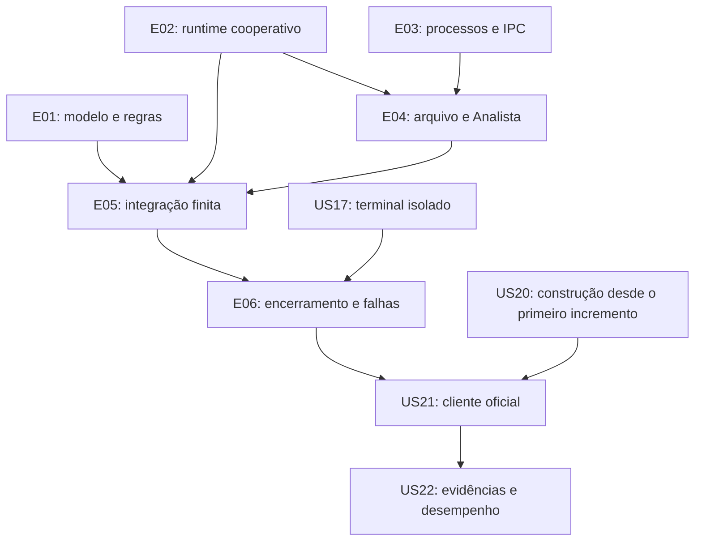

# Histórias de usuário e habilitadores técnicos

Status inicial: todas as histórias estão **não iniciadas**. Esta entrega documenta o trabalho; não implementa as funcionalidades descritas.

Referências: [arquitetura](architecture.md) e [padrões para desenvolvimento com IA](../AGENTS.md). Os identificadores R01–R18, P01–P05 e D01–D13 são definidos na arquitetura. R identifica exigência do professor; P identifica o contrato do cliente de referência; D identifica decisão do projeto.

## 1. Organização, independência e conclusão

As histórias funcionais usam a perspectiva de quem executa ou avalia o programa. Contextos, IPC e outras capacidades internas são classificados como **habilitadores técnicos**, sem inventar um usuário para uma operação de baixo nível.

A ordem recomendada é E01 → E02 → E03 → E04 → E05 → E06 → E07. E01, E02 e as bases de E03 podem avançar independentemente. E04 pode ser validado com arquivo e processos controlados, sem geração real de clientes. US17 é independente. Histórias de integração explicitam suas dependências, em vez de pressupor que todas as anteriores precisam estar prontas.

Dentro de cada etapa, preparar o mínimo de compilação e execução de testes previsto em US20; sua consolidação documental fica em E07. Não esperar até o final para compilar. Cada história introduz seus testes junto da funcionalidade, não em uma fase posterior separada.

### Critério de conclusão compartilhado

- Todos os critérios específicos e requisitos associados foram demonstrados.
- Código próprio compila sem novos avisos relevantes e respeita os limites dos módulos.
- Os testes pertinentes foram executados, com resultado registrado em docs/verification.md quando esse documento for criado em US20.
- Propriedade e liberação de recursos foram verificadas, inclusive em erro quando aplicável.
- Documentos foram atualizados se houve mudança de contrato ou decisão.
- Não houve ampliação de escopo, modificação do cliente oficial ou alteração artificial de métricas.

Os nomes de arquivos de testes abaixo são os da árvore planejada. Usar fixtures e interfaces de teste para validar um módulo sem acoplar sua entrega à conclusão dos demais. Testes com processos devem usar watchdog externo; isso não cria timeout no atendimento normal.

## 2. Épicos e histórias ordenadas

## E01 — Modelo de clientes e regras de atendimento

**Resultado:** regras verificáveis sem executar processos, acessar arquivos ou criar threads.

### US01 — Representar clientes e suas transições

**Tipo:** habilitador técnico. **Dependências:** nenhuma. **Rastreabilidade:** R05, R13; D11.

**Objetivo e benefício:** representar um cliente de maneira única, preservando os dados necessários para seleção, métricas e liberação de recursos.

**Critérios de aceitação:**

- Dado um cliente criado, seu registro preserva PID, sequência, prioridade, chegada, demanda e prazo, sem confundir instante de chegada com instante de enfileiramento.
- Estados STARTING, QUEUED, IN_SERVICE, COMPLETED, CANCELLED e FAILED distinguem o ciclo de vida; uma transição terminal não é contabilizada duas vezes.
- Dado X = 5 ms, a paciência alta corresponde a 2,5 ms; entradas que causam overflow não produzem prazos silenciosamente incorretos.

**Passos:**

1. Definir tipos, estados, unidades e campos em domain/client.h.
2. Documentar transições permitidas e propriedade do registro em cada etapa.
3. Estabelecer as operações verificadas de cálculo de paciência/prazo junto das regras do domínio, usando durações recebidas pelo chamador.
4. Adicionar casos de estados, prioridades e limites em domain_test.c.

**Verificação:** registros artificiais; X par/ímpar; limite de representação; tentativa de registrar novamente uma transição terminal. Nenhum relógio real é necessário.

### US02 — Controlar capacidade e selecionar o próximo cliente

**Tipo:** habilitador técnico. **Dependências:** US01. **Rastreabilidade:** R13, R15; D05, D06, D07.

**Objetivo e benefício:** manter clientes esperando com consumo limitado de recursos e seleção simples por prazo absoluto.

**Critérios de aceitação:**

- Com 100 vagas ocupadas/reservadas para espera, uma nova reserva é recusada sem perder ou sobrescrever registros; retirada libera capacidade.
- A seleção retorna o menor prazo absoluto, desempatando pela sequência de criação.
- Cliente com prazo vencido continua elegível; fila vazia retorna ausência de cliente, sem acesso inválido.
- Um cliente IN_SERVICE não é contado como esperando; a reserva STARTING impede criar além da capacidade disponível.

**Passos:**

1. Implementar vetor limitado e interface de consulta, inserção e retirada.
2. Estabelecer no contexto da aplicação a reserva de capacidade antes da criação, sem exigir um registro QUEUED incompleto.
3. Implementar seleção linear e transferência de propriedade ao retirar.
4. Cobrir capacidade, ordem, empate e esvaziamento em testes.

**Verificação:** 0, 1 e 100 elementos; 101ª reserva; prazos misturados, iguais e vencidos; remoção seguida de nova reserva. Não exigir preferência absoluta por alta prioridade.

### US03 — Calcular satisfação e acumular métricas

**Tipo:** habilitador técnico. **Dependências:** US01. **Rastreabilidade:** R05, R06, R07, R08, R18; D11.

**Objetivo e benefício:** produzir resultados verificáveis sem depender da velocidade da máquina.

**Critérios de aceitação:**

- Conclusão igual ao prazo é satisfeita; um incremento acima do prazo é insatisfeito.
- O cálculo inclui o intervalo desde a chegada, sem reiniciar ao começar o serviço.
- No finito bem-sucedido, a taxa é satisfeitos/N; no infinito, satisfeitos/concluídos, excluindo cancelados.
- Com zero concluídos, a taxa é não aplicável. Contadores não sofrem dupla atualização e operações inválidas são diagnosticadas.

**Passos:**

1. Definir contadores e resultado em metrics.h.
2. Implementar registro de criação, conclusão, cancelamento e falha com responsabilidades explícitas.
3. Implementar cálculo da taxa e duração total a partir de instantes recebidos; implementar platform/clock separadamente para obter CLOCK_MONOTONIC e converter unidades sem levar essa dependência ao domínio.
4. Testar limites e invariantes, sem consultar o relógio dentro do domínio.

**Verificação:** tempos sintéticos nos limites, X ímpar, uma conclusão, mistura de concluídos/cancelados, zero concluídos e contagens finitas incompletas, que não podem ser apresentadas como sucesso.

## E02 — Runtime de threads cooperativas

**Resultado:** duas linhas de execução com contextos e pilhas próprios, independentes das regras de clientes.

### US04 — Criar contextos e gerenciar pilhas

**Tipo:** habilitador técnico. **Dependências:** nenhuma. **Rastreabilidade:** R01, R02; D01, D02, D03.

**Objetivo e benefício:** implementar threads reais em espaço de usuário sem biblioteca que substitua o trabalho exigido.

**Critérios de aceitação:**

- Duas rotinas podem ter contextos e pilhas independentes e retornar ao escalonador.
- Variáveis locais de uma rotina permanecem preservadas após uma troca de contexto.
- Falha de alocação/inicialização não deixa pilhas adquiridas sem liberação.
- Uma pilha só é liberada a partir de outro contexto; APIs pthread não são utilizadas.

**Passos:**

1. Conferir disponibilidade da família ucontext no ambiente Linux/glibc alvo.
2. Definir descritor, contexto do escalonador, pilhas e retorno/trampoline das rotinas.
3. Implementar criação e destruição com tratamento de falha parcial.
4. Criar testes mínimos de contextos e preservação de estado.

**Verificação:** scheduler_test.c com duas rotinas sintéticas e encerramento em ordens diferentes; análise de memória com ferramenta compatível e limites documentados.

### US05 — Alternar somente threads prontas

**Tipo:** habilitador técnico. **Dependências:** US04. **Rastreabilidade:** R02; D04.

**Objetivo e benefício:** garantir progresso cooperativo previsível sem regras de atendimento no runtime.

**Critérios de aceitação:**

- Duas threads READY alternam por round-robin ao ceder execução.
- FINISHED não volta a executar e a última thread pode retornar ao escalonador com segurança.
- Cada descritor tem estado coerente; não há duas threads RUNNING ao mesmo tempo.
- Não há timer preemptivo, espera ocupada para simular alternância nem dependência de clientes.

**Passos:**

1. Implementar fila de prontas e estados READY/RUNNING/WAITING/FINISHED.
2. Implementar cessão explícita e tratamento de retorno de rotina.
3. Definir o laço de despacho e sua saída quando todas terminam.
4. Testar sequências observáveis sem depender de tempos de parede.

**Verificação:** alternância repetida, apenas uma pronta, término de uma das duas e retorno da última. Verificar que a ordem é produzida pelo escalonador próprio.

### US06 — Suspender por condição e retomar por evento

**Tipo:** habilitador técnico. **Dependências:** US05. **Rastreabilidade:** R02, R15; D04.

**Objetivo e benefício:** permitir espera por recursos sem bloquear o progresso de outra thread de usuário.

**Critérios de aceitação:**

- Thread WAITING deixa de ser despachada e retorna a READY quando sua condição é notificada.
- A condição é verificada antes de dormir e após retomar, sem despertar perdido ou execução duplicada.
- O callback de eventos é chamado entre despachos; quando não há prontas, o runtime delega espera ao callback em vez de girar em loop.
- O runtime funciona com eventos artificiais, sem conhecer PIDs, semáforos ou terminal.

**Passos:**

1. Definir identificadores de espera e operações de aguardar/despertar.
2. Integrar o callback de processamento de eventos com contexto explícito.
3. Garantir que atualizações de estruturas internas não cedam no meio de invariantes.
4. Testar eventos antecipados, múltiplos interessados e todas as threads esperando.

**Verificação:** scheduler_test.c com fonte controlada de eventos; verificar ausência de busy waiting e retomada sem trabalho duplicado.

## E03 — Processos clientes e mecanismos de IPC

**Resultado:** adaptadores verificáveis sem depender da execução completa do serviço.

### US07 — Criar, observar e recolher processos filhos

**Tipo:** habilitador técnico. **Dependências:** nenhuma. **Rastreabilidade:** R01, R13, R17; D07.

**Objetivo e benefício:** controlar processos reais e distinguir parada, conclusão e falha com um único ponto de coleta.

**Critérios de aceitação:**

- fork/exec devolvem a identidade do filho ou um diagnóstico; falha de exec não é confundida com atendimento concluído.
- A coleta não bloqueante distingue parada inicial, término normal e término por sinal por PID, preservando o código de saída; status diferente de zero não é sucesso de atendimento.
- Múltiplas mudanças são esgotadas mesmo quando há uma única notificação SIGCHLD.
- Filhos terminados são recolhidos; o caminho pós-fork fecha recursos desnecessários e não herda configuração imprópria do pai.

**Passos:**

1. Definir eventos e operações em processes.h.
2. Implementar criação, sinalização e coleta central com waitpid não bloqueante.
3. Implementar máscara de sinais e espera por eventos sem janela de notificação perdida.
4. Iniciar controlled_client.c com modos de parada, saída e falha, exclusivos de teste.

**Verificação:** processo que para e retoma, saída normal, sinal fatal, caminho de executável inválido e vários filhos terminando juntos; watchdog externo e conferência de zumbis.

### US08 — Inicializar clientes sem sobrescrever a demanda

**Tipo:** habilitador técnico. **Dependências:** US01, US07. **Rastreabilidade:** R13, R14, R17; P01, P03, P05; D07, D10.

**Objetivo e benefício:** obter a demanda correta de cada cliente usando seu protocolo original.

**Critérios de aceitação:**

- Só ler demanda.txt após observar a parada inicial do cliente correspondente.
- Só permitir a criação seguinte depois de consumir a demanda anterior; existe no máximo um STARTING.
- Chegada é registrada imediatamente antes da criação, e não depois da leitura do arquivo.
- Demanda ausente, inválida ou incompatível com o protocolo resulta em erro explícito, sem enfileirar um registro incompleto.
- A unidade de demanda do cliente de referência permanece em microssegundos, independentemente da unidade de X.

**Passos:**

1. Preparar a inicialização do cliente com diretório de trabalho e caminhos resolvidos.
2. Associar PID e chegada à criação e observar sua parada.
3. Ler e validar o arquivo compartilhado; removê-lo depois do consumo seguro.
4. Devolver um registro inicializado ao chamador e liberar a permissão para a próxima criação.

**Verificação:** clientes controlados com demandas diferentes, atraso antes de SIGSTOP, arquivo inválido e saída antes da parada; ausência de associação cruzada entre demanda e PID.

### US09 — Possuir semáforos e impedir instâncias conflitantes

**Tipo:** habilitador técnico. **Dependências:** nenhuma. **Rastreabilidade:** R01, R16; P02; D09.

**Objetivo e benefício:** preparar recursos de IPC compatíveis com o cliente sem interferir em outras execuções.

**Critérios de aceitação:**

- /sem_atend e /sem_block são criados inicialmente disponíveis antes dos usuários desses recursos.
- Uma segunda instância não inicia clientes nem remove recursos da primeira.
- Recurso preexistente não é apagado silenciosamente; falhas parciais liberam somente os recursos adquiridos nesta execução.
- O caminho do Atendimento oferece tentativa não bloqueante; indisponibilidade não paralisa as duas threads.

**Passos:**

1. Implementar bloqueio de instância e identificação de propriedade.
2. Criar semáforos com verificação de existência e permissões adequadas.
3. Expor aquisição imediata, liberação e fechamento idempotente conforme o recurso.
4. Testar falhas intermediárias e encerramento normal.

**Verificação:** duas instâncias concorrentes, semáforo preexistente de fixture isolada, tentativa indisponível e liberação parcial. Não remover semáforos reais de terceiros para preparar os testes.

## E04 — Registro de atendimentos e Analista

**Resultado:** registro e consumo em lotes podem ser exercitados com PIDs de teste, sem Recepção real.

### US10 — Registrar PIDs concluídos em ordem

**Tipo:** habilitador técnico. **Dependências:** US09. **Rastreabilidade:** R09, R11, R16.

**Objetivo e benefício:** fornecer um arquivo compartilhado simples cujo conteúdo represente atendimentos concluídos ainda não impressos.

**Critérios de aceitação:**

- Cada inclusão bem-sucedida acrescenta um PID decimal completo por linha, preservando registros anteriores e ordem.
- Consumo de até dez remove apenas o prefixo consumido; o restante permanece íntegro e na mesma ordem.
- Escrita parcial, leitura inválida e erro de compactação produzem diagnóstico; não há truncamento cego do arquivo inteiro.
- Operações respeitam acesso exclusivo e não dependem da política de despertar.

**Passos:**

1. Definir formato e resultados das operações em completion_file.h.
2. Implementar inclusão e leitura/compactação com tratamento de I/O parcial.
3. Integrar a proteção do arquivo com o protocolo de exclusão.
4. Criar cenários controlados de consumo e falha em integration_test.sh.

**Verificação:** arquivos com 0, 1, 10, 11 e 27 registros, múltiplos lotes, linha inválida e falha de escrita. O consumidor de teste só confirma remoção após confirmação da saída.

### US11 — Imprimir lotes com um Analista inicialmente parado

**Tipo:** história funcional. **Dependências:** US07, US09, US10. **Rastreabilidade:** R09, R10, R11, R16.

**História:** como pessoa que acompanha o atendimento, quero ver os PIDs concluídos em lotes para observar os resultados sem uma impressão contínua descontrolada.

**Critérios de aceitação:**

- Após iniciar, o Analista escreve analyst.pid correspondente à sua identidade e para antes de imprimir qualquer PID.
- Cada SIGCONT autorizado imprime no máximo os dez primeiros registros; dados posteriores não são antecipados.
- O Analista confirma a escrita da saída, remove os impressos, libera a proteção e volta a parar.
- Erro de saída/arquivo encerra com falha, sem reportar que o lote foi consumido com sucesso.

**Passos:**

1. Implementar a entrada do Analista com diretório e recursos recebidos do pai.
2. Escrever identificação e realizar parada inicial.
3. Executar um único lote por retomada, reutilizando o módulo do arquivo.
4. Liberar proteção antes de nova parada e tratar erros e término.

**Verificação:** confirmar estado parado antes do primeiro despertar; arquivos de 1/10/11/27 registros; contagem por despertar; falha da saída padrão e ausência de remoção de registros não impressos.

### US12 — Coordenar despertares e drenar pendências

**Tipo:** habilitador técnico. **Dependências:** US06, US11. **Rastreabilidade:** R10, R11, R12; D12.

**Objetivo e benefício:** conectar o pedido do Atendente ao Analista sem perder despertares ou encerrar com PIDs pendentes.

**Critérios de aceitação:**

- Nenhum SIGCONT é enviado antes da parada inicial ou enquanto o lote anterior estiver ativo.
- Dez registros pendentes, ociosidade com registros ou solicitação de drenagem provocam o próximo despertar elegível.
- Enquanto o Analista está ativo, inclusões aguardam sua parada sem bloquear o runtime; a Recepção pode continuar.
- Para 27 registros, a drenagem exige lotes de 10, 10 e 7 e só termina após confirmação de parada e arquivo vazio.

**Passos:**

1. Definir estados do Analista e dados do lote em voo na aplicação.
2. Conectar solicitações do Atendente a eventos e esperas do runtime.
3. Aplicar a política de despertar com exclusão entre consumo e inclusão.
4. Implementar drenagem repetida e erro quando o Analista termina inesperadamente.

**Verificação:** processos controlados e registros sintéticos; pedidos repetidos de despertar, conclusão durante lote ativo e morte do Analista. Não inferir sucesso pelo número de sinais enviados.

## E05 — Execução integrada do atendimento

**Resultado:** executar o fluxo finito de ponta a ponta, preservando as políticas já verificadas isoladamente.

### US13 — Validar entradas e inicializar o serviço

**Tipo:** história funcional. **Dependências:** US03, US06, US09. **Rastreabilidade:** R01, R02, R03; D01, D09, D13.

**História:** como pessoa que executa o projeto, quero informar N e X e receber diagnósticos claros para iniciar um cenário válido.

**Critérios de aceitação:**

- service N X aceita N inteiro não negativo e X inteiro positivo representáveis; rejeita argumentos ausentes/extras, negativos, conteúdo residual e overflow antes de criar filhos.
- N = 0 seleciona o modo infinito; não é convertido em uma quantidade finita oculta.
- Caminhos dos executáveis são resolvidos antes da mudança de diretório, e dados de uma execução ficam em seu próprio run/<execution-id>/.
- Inicialização prepara recursos, runtime e duas rotinas distintas; componentes ainda não integrados podem ser representados por fixtures nesta história.

**Passos:**

1. Implementar validação na entrada e contrato de configuração/resultado em service.h.
2. Preparar diretório, bloqueio e recursos e iniciar a medição total.
3. Conectar o processamento de eventos da plataforma ao runtime.
4. Preparar retorno de erro e liberação das aquisições iniciais para posterior consolidação em US19.

**Verificação:** tabela de entradas válidas/inválidas, caminho com espaços, execução de outro diretório e falha intermediária na preparação; inválidos não deixam filhos ou semáforos.

### US14 — Gerar clientes pela Recepção com controle de capacidade

**Tipo:** história funcional. **Dependências:** US02, US06, US08, US13. **Rastreabilidade:** R02, R03, R04, R05, R13, R14, R15.

**História:** como pessoa que executa o cenário, quero que clientes sejam criados com as prioridades especificadas para avaliar uma carga válida do trabalho.

**Critérios de aceitação:**

- No finito, a Recepção cria exatamente N clientes ao longo da execução, sem parar definitivamente na capacidade 100.
- No infinito, a geração continua enquanto autorizada e para temporariamente com 100 clientes esperando.
- Cada cliente recebe um sorteio equiprovável independente de alta/baixa; a fonte pseudoaleatória do serviço é inicializada uma vez. Não se exige metade exata em uma amostra.
- Criação respeita a reserva STARTING e a leitura serializada; a Recepção cede/aguarda em etapas limitadas.

**Passos:**

1. Implementar a rotina Recepção em workers.c, usando os adaptadores existentes.
2. Associar sorteio, paciência, chegada e reserva antes da criação.
3. Enfileirar somente registros inicializados e notificar o Atendente.
4. Aguardar capacidade e respeitar fim da geração/parada solicitada.

**Verificação:** N = 1, N > 100 com consumidor controlado, N = 0 com limite imposto pelo teste, fila cheia/retomada e conferência do mapeamento equiprovável do gerador. Amostras exploratórias não serão um teste probabilístico frágil que exige exatamente 50%.

### US15 — Atender e confirmar a conclusão de cada cliente

**Tipo:** história funcional. **Dependências:** US02, US03, US06, US07, US09, US12, US13. **Rastreabilidade:** R02, R06, R09, R10, R16, R17.

**História:** como pessoa que avalia o serviço, quero que um cliente seja atendido por vez e sua conclusão seja comprovada para confiar nas métricas e nos PIDs publicados.

**Critérios de aceitação:**

- A thread Atendente seleciona por prazo, libera a vaga de espera e retoma somente um cliente inicialmente parado.
- O término normal recolhido com status zero confirma atendimento; semáforo disponível ou mera duração estimada não confirmam conclusão.
- A espera de um cliente não impede Recepção/eventos; fila vazia suspende o Atendente sem busy waiting.
- A conclusão atualiza métricas e arquivo uma única vez; se o Analista estiver ativo, o PID fica pendente e não se inicia outro atendimento antes de registrá-lo.

**Passos:**

1. Implementar a rotina Atendente com seleção e transição IN_SERVICE.
2. Enviar SIGCONT e aguardar o evento de término daquele PID.
3. Capturar o instante observado e registrar satisfação, sem incluir atrasos posteriores do arquivo nessa conclusão.
4. Persistir PID, solicitar despertar quando pertinente e preparar o próximo ciclo.

**Verificação:** fila preenchida por fixture, sem depender de US14; cliente atrasado antes de adquirir o semáforo, término por sinal, cliente com prazo vencido e Analista ativo durante conclusão.

### US16 — Concluir execução finita e apresentar resultados

**Tipo:** história funcional. **Dependências:** US14, US15. **Rastreabilidade:** R03, R06, R07, R09, R11, R18.

**História:** como pessoa que avalia o trabalho, quero executar uma quantidade finita de clientes e obter satisfação e duração total para comparar o resultado corretamente.

**Critérios de aceitação:**

- Sucesso exige criados = concluídos = N, sem cancelamento ou falha ocultados.
- O último lote parcial é impresso e o arquivo esvaziado antes de encerrar o Analista.
- O relatório apresenta contadores, taxa satisfeitos/N e tempo total incluindo drenagem e limpeza.
- PIDs do Analista precedem o relatório final sem disputa de escrita; diagnósticos usam stderr.

**Passos:**

1. Conectar as duas rotinas ao serviço sem fixtures no caminho de atendimento.
2. Detectar fim da geração sem encerrar prematuramente o Atendente.
3. Aguardar conclusões e solicitar drenagem final.
4. Encerrar/recolher o Analista, liberar recursos e apresentar o resultado.

**Verificação:** N = 1, N = 11 e N > 100; cada PID concluído aparece uma vez em execução normal; soma de satisfeitos/insatisfeitos corresponde a N; nenhum filho permanece.

## E06 — Interrupção, falhas e integridade da execução

**Resultado:** parar o programa preservando os resultados já concluídos e os recursos do ambiente.

### US17 — Capturar s e restaurar o terminal

**Tipo:** história funcional. **Dependências:** nenhuma. **Rastreabilidade:** R08; D08.

**História:** como pessoa que executa o modo infinito, quero solicitar a parada com a tecla s sem precisar de Enter e continuar usando o terminal normalmente depois.

**Critérios de aceitação:**

- Em TTY, s é detectado sem Enter; outras teclas não solicitam parada.
- Em entrada redirecionada, um byte s também é reconhecido sem usar termios.
- A leitura não bloqueia os workers, e restauração recupera flags e atributos anteriores, inclusive após erro parcial.
- EOF não provoca giro contínuo: no infinito solicita encerramento com erro; no finito desativa o monitoramento da entrada.

**Passos:**

1. Encapsular snapshot, preparação e restauração do terminal.
2. Expor leitura não bloqueante e disponibilidade do descritor.
3. Tratar TTY, redirecionamento e EOF conforme o contrato.
4. Preparar teste com pseudoterminal e restauração verificável.

**Verificação:** TTY/pseudoterminal, pipe com s, outras teclas, EOF, erro de preparação e duas chamadas de restauração. SIGKILL está fora da garantia de limpeza.

### US18 — Encerrar o modo infinito sem perder PIDs concluídos

**Tipo:** história funcional. **Dependências:** US16, US17. **Rastreabilidade:** R03, R08, R09, R10, R11, R12, R15, R18; D08.

**História:** como pessoa que executa uma carga contínua, quero pará-la e receber todos os PIDs já atendidos e métricas somente desses atendimentos.

**Critérios de aceitação:**

- Após observar s, não criar novos clientes nem iniciar outro atendimento; concluir apenas o que já estava IN_SERVICE.
- Cancelar e recolher QUEUED e STARTING; nenhum deles entra no denominador como atendimento concluído.
- Drenar todos os PIDs, aguardando cada lote e verificando arquivo vazio antes de finalizar, inclusive com Analista já ativo.
- Com zero concluídos, apresentar taxa não aplicável. O tempo total inclui drenagem e limpeza.

**Passos:**

1. Implementar transições STOPPING e DRAINING coordenadas pelo serviço.
2. Interromper a Recepção e impedir novo despacho de atendimento.
3. Finalizar o atual, cancelar os demais e recolher todos os filhos.
4. Executar drenagem repetida e finalizar com relatório consistente.

**Verificação:** s antes da primeira conclusão, com fila cheia, durante STARTING, durante atendimento e durante lote do Analista; backlog sintético de 27 PIDs; ausência de órfãos/zumbis.

### US19 — Tratar falhas e limpar inicialização parcial

**Tipo:** habilitador técnico. **Dependências:** US13, US15, US18. **Rastreabilidade:** R01, R07, R08, R09, R12, R16, R17, R18.

**Objetivo e benefício:** consolidar os caminhos de erro já introduzidos nas histórias anteriores, sem apresentar resultados inválidos como sucesso.

**Critérios de aceitação:**

- Falha de criação/exec, demanda inválida, término anormal de cliente, morte do Analista e erro de arquivo/saída produzem diagnóstico e status não zero.
- Limpeza funciona após qualquer prefixo de inicialização e não libera ou fecha o mesmo recurso duas vezes.
- SIGINT/SIGTERM acionam encerramento controlado e restauração, com diagnóstico da interrupção.
- Recursos de outra execução não são removidos; dados pendentes após erro são identificados como parciais, sem alegar drenagem bem-sucedida.

**Passos:**

1. Enumerar aquisições e seus proprietários no contexto da execução.
2. Centralizar finalização e conectar erros locais a esse fluxo.
3. Consolidar limpeza de filhos, pilhas, arquivos próprios, semáforos, máscaras e terminal.
4. Exercitar falhas por fixtures e pontos controlados, sem mecanismos de injeção no caminho normal do produto.

**Verificação:** falha após cada aquisição relevante, encerramento durante espera, sinal externo e Analista morto com registros pendentes; conferir diagnóstico, status, terminal e processos. Não exigir recuperação de SIGKILL ou de cliente defeituoso que nunca termina; usar watchdog externo no teste.

## E07 — Construção, compatibilidade e avaliação

**Resultado:** reprodução e evidências de conformidade, sem alterar a carga para melhorar a nota.

### US20 — Padronizar compilação, execução e verificações

**Tipo:** habilitador técnico. **Dependências:** nenhuma para iniciar; finalizar os alvos conforme os módulos forem entregues. **Rastreabilidade:** R01, R02, R17; D01.

**Objetivo e benefício:** permitir que outra pessoa construa e verifique o projeto sem depender de comandos informais da sessão de desenvolvimento.

**Critérios de aceitação:**

- Makefile organiza objetos/binários em build/ e disponibiliza alvos documentados de construção, testes, depuração e limpeza dos próprios artefatos.
- Código próprio usa C17 e avisos fortes, sem dependências externas de execução; avisos do cliente fornecido não motivam alteração de seu comportamento.
- README explica ambiente, service N X, modo infinito, métricas, restrições e procedimento para disponibilizar o cliente oficial.
- .gitignore exclui build/ e run/; docs/verification.md registra comandos realmente executados e limitações de ferramentas.

**Passos:**

1. Preparar compilação mínima e testes do primeiro módulo, expandindo os alvos conforme a implementação existir.
2. Centralizar opções e macros de recursos necessários às interfaces de plataforma.
3. Adicionar construção dos três executáveis e os alvos de verificação pertinentes.
4. Documentar reprodução, separação do cliente oficial e limpeza segura.

**Verificação:** construir a partir de estado limpo com dependências documentadas; recompilar após mudança de cabeçalho; executar testes; conferir que limpeza não remove arquivos-fonte nem recursos de outra execução.

### US21 — Validar integração com o cliente oficial

**Tipo:** história funcional. **Dependências:** US16, US18, US19, US20. **Rastreabilidade:** R01–R18; P01–P05.

**História:** como pessoa que avalia o trabalho, quero reproduzir os fluxos com o cliente do professor para confirmar que a solução atende ao protocolo real.

**Critérios de aceitação:**

- provided/client.c corresponde à fonte oficial recebida/conferida e sua origem está registrada; cliente de teste não substitui essa evidência.
- Nome de demanda, unidade, parada inicial e semáforo correspondem à fonte real; divergências do PDF são documentadas antes de adaptar a integração.
- Finito e infinito passam com o cliente oficial, incluindo lotes parciais, fila limitada, parada por s e limpeza.
- O conjunto de testes controlados continua exercitando limites exatos e falhas que não são reproduzíveis apenas com a carga aleatória oficial.

**Passos:**

1. Obter ou conferir a fonte oficial e registrar sua versão/origem sem reescrevê-la para otimização.
2. Revisar as particularidades P e ajustar somente o adaptador quando necessário e compatível com o enunciado.
3. Executar cenários finitos e infinitos do teste de integração.
4. Registrar resultados, diferenças e pendências reais em verification.md.

**Verificação:** matriz completa com fonte oficial, arquivo de PIDs e relatório; se a fonte ainda não estiver disponível/conferida, manter esta história pendente em vez de afirmar compatibilidade.

### US22 — Medir desempenho e demonstrar cobertura

**Tipo:** história funcional. **Dependências:** US21. **Rastreabilidade:** R04, R06, R07, R08, R18; contexto de avaliação competitiva.

**História:** como pessoa que apresenta o projeto, quero demonstrar correção, satisfação e duração em condições conhecidas para explicar seus resultados e eventuais otimizações.

**Critérios de aceitação:**

- A matriz de rastreabilidade tem evidência ou pendência explícita para todos os requisitos; nenhum é considerado coberto apenas porque há código correspondente.
- Medições registram N/X, ambiente, versão, política, quantidade de repetições e satisfação/tempo total, separando carga controlada de carga oficial.
- Comparações mantêm condições equivalentes e incluem os custos de execução definidos; não removem clientes vencidos ou etapas para melhorar números.
- Otimizações só são aceitas se mantiverem as verificações funcionais e a integridade do cliente oficial.

**Passos:**

1. Executar e registrar a matriz funcional e de recursos.
2. Definir cenários repetíveis com cliente controlado e cenários reais com o oficial, sem alegar que este último tem demanda reproduzível.
3. Repetir medições e apresentar os resultados e sua variação em verification.md.
4. Avaliar gargalos demonstrados, documentando qualquer revisão de decisão antes de implementar otimizações.

**Verificação:** comparação de relatórios, conferência de denominadores, ordem dos lotes e ausência de resíduos; nenhuma promessa de nota ou desempenho superior sem evidência.

## 3. Dependências e sequência de integração

As dependências precisas são as listadas em cada história. O diagrama agrupa subsistemas, não exige execução estritamente serial. Exemplos de independência: US01 e US04; US07 e US09; US17 e E01–E04; US15 pode usar fila de fixture sem aguardar US14. Não criar dependência circular entre fila e processos ou entre runtime e regras de atendimento.

## 4. Matriz de rastreabilidade

| Requisito | Histórias responsáveis | Verificação necessária |
|---|---|---|
| R01 — Linux/C e restrição de bibliotecas | US04, US07, US09, US13, US20, US21 | Construção Linux, revisão de dependências/APIs e execução real. |
| R02 — Recepção/Atendente e contextos próprios | US04, US05, US06, US13, US14, US15 | Pilhas/contextos independentes, alternância e progresso durante espera. |
| R03 — N finito ou infinito e entrada X | US13, US14, US16, US18 | N = 1, N > 100, N = 0 e entradas inválidas. |
| R04 — Prioridades equiprováveis | US14, US22 | Revisão do sorteio uniforme e seu mapeamento, sem exigir metade exata da amostra. |
| R05 — Paciência X e X/2 ms | US01, US03, US14 | X par/ímpar, preservação de meia unidade de ms e conversões. |
| R06 — Conclusão menos chegada ≤ paciência | US03, US15, US16, US22 | Igualdade, imediatamente acima e medição incluindo espera/serviço. |
| R07 — Atender todos no finito e taxa correta | US03, US16, US19, US21 | Criados = concluídos = N em sucesso; falha não mascarada. |
| R08 — s e denominador do infinito | US03, US17, US18, US21 | s em estados distintos, cancelados excluídos e zero concluídos. |
| R09 — PID de cada atendido em arquivo | US10, US11, US15, US16, US18 | Correspondência entre concluídos, arquivo e saída, sem duplicação normal. |
| R10 — Analista dormindo e despertado pelo Atendente | US11, US12, US15 | Parada inicial observada e pedidos de despertar coordenados. |
| R11 — Até dez primeiros por despertar e remoção | US10, US11, US12, US16 | Arquivos de 1/10/11/27; ordem e preservação do restante. |
| R12 — Drenagem antes do término infinito | US12, US18, US19, US21 | Lotes sucessivos, confirmação de parada, arquivo vazio e falhas não mascaradas. |
| R13 — Dados do cliente e chegada na criação | US01, US02, US07, US08, US14 | Registro completo e chegada anterior ao enfileiramento. |
| R14 — Demanda compartilhada serializada | US08, US14, US21 | Demandas diferentes sem sobrescrita e nenhum QUEUED incompleto. |
| R15 — Limite 100 e retomada no infinito | US02, US06, US14, US18 | Limite, reserva STARTING, espera, retomada e parada com fila cheia. |
| R16 — Semáforos e identificação do Analista | US09, US10, US11, US15, US19, US21 | Inicialização, exclusão, PID correspondente e limpeza dos próprios recursos. |
| R17 — Mesmo cliente fornecido | US07, US08, US15, US20, US21 | Conferência de origem/fonte e teste com executável oficial. |
| R18 — Tempo total | US03, US16, US18, US19, US22 | Medição monotônica incluindo drenagem/limpeza e relatório com status. |

## 5. Cenários de aceitação transversal

| Cenário | Evidência esperada |
|---|---|
| Finito com mais de 100 clientes | Geração retoma após liberar vagas e todos concluem; extensão do limite ao finito identificada como D06. |
| X ímpar e conclusão no limite | Preservação de X/2 e igualdade aceita; testes de domínio não dependem do escalonamento da máquina. |
| Múltiplos eventos agrupados | Todos os estados relevantes são coletados; nenhuma associação por PID é perdida. |
| Analista inicialmente parado | Nenhum PID impresso antes de um despertar autorizado. |
| Arquivo com 27 registros | Saída por lotes de 10/10/7, sem perda dos registros restantes. |
| s durante criação, fila cheia, atendimento ou análise | Nenhum novo atendimento após parada; conclusão do atual e drenagem antes da saída. |
| Sem concluídos | Taxa não aplicável; zero no contador, sem divisão por zero. |
| Falha parcial de inicialização | Recursos já adquiridos são liberados; recursos alheios permanecem intactos. |
| Falha do cliente, arquivo ou Analista | Diagnóstico/status de erro e resultado parcial identificado; não afirmar conformidade do cenário incompleto. |
| Saída controlada | Terminal restaurado e todos os filhos recolhidos, sem sobreviventes ou zumbis. |

Estes cenários complementam os critérios das histórias; não substituem testes nem indicam funcionalidades implementadas.
