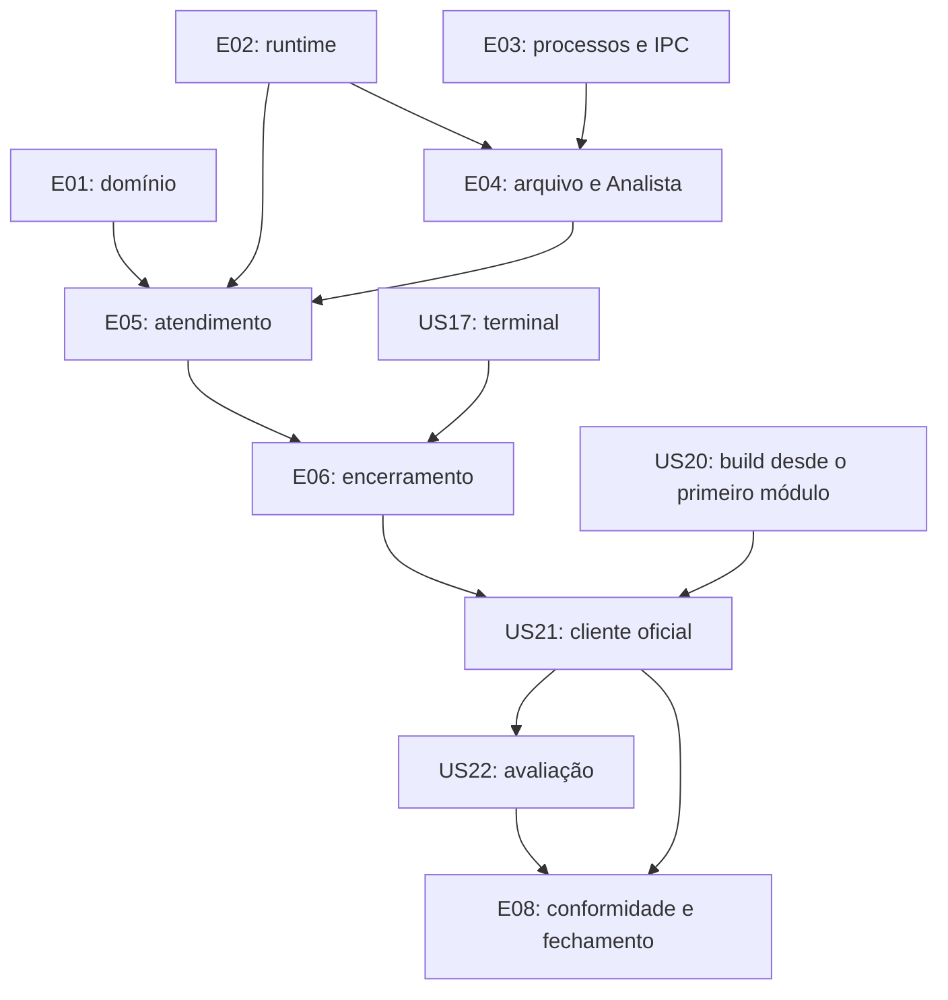

# Backlog da primeira parte

As histórias abaixo organizam a implementação descrita na [arquitetura](architecture.md). R01–R18 são requisitos do professor, P01–P05 descrevem o cliente do enunciado e D01–D13 são decisões do projeto. Consulte também as [convenções do repositório](../AGENTS.md). As verificações de US01–US22 continuam registradas. A auditoria posterior encontrou lacunas de conformidade e casos de falha fora da cobertura existente. O fechamento da primeira parte depende de US23–US27. [Evidências da auditoria](verification.md#auditoria-de-conformidade-após-o-épico-7).

## Como usar o backlog

Os épicos estão em ordem de integração. Domínio, runtime e adaptadores de processos podem avançar em paralelo; as dependências de cada história indicam o mínimo necessário para concluí-la. US17 (terminal) é independente. Comece a estrutura de compilação de US20 junto ao primeiro módulo e complete seus alvos conforme surgirem fontes; não espere o fim do projeto para compilar.

Histórias funcionais descrevem comportamento percebido por quem executa ou avalia o programa. Rotinas internas aparecem como **habilitadores técnicos**, com resultado verificável em vez de um usuário fictício.

Uma história está concluída quando seus critérios de aceite e requisitos associados foram verificados, os testes pertinentes passaram, recursos foram liberados nos caminhos relevantes e a documentação afetada foi atualizada. Registre comandos e resultados em `docs/verification.md` quando esse documento for criado em US20. O cliente de testes ajuda a reproduzir erros; só o cliente oficial comprova compatibilidade com a entrega.

## E01 — Modelo e regras

Resultado: domínio testável com dados e instantes artificiais, sem processos nem I/O.

### US01 — Definir o registro e os estados do cliente

**Tipo:** técnico · **Depende de:** nada · **Cobre:** R05, R13; D11.

**Estado:** concluída em 2026-10-22. Registro e transições em `src/domain/client.{h,c}`, com cinco grupos de testes determinísticos em `tests/domain_test.c`. Comandos e limites da verificação estão no [registro](verification.md#us01--registro-e-estados-do-cliente).

**Entrega:** um registro com PID, sequência, prioridade, chegada, demanda, prazo e estado. Estados: `STARTING`, `QUEUED`, `IN_SERVICE`, `COMPLETED`, `CANCELLED` e `FAILED`.

**Aceite:**

- A chegada permanece associada à criação, não à entrada na fila; uma conclusão ou cancelamento não pode ser registrado duas vezes.
- X = 5 ms resulta em 2,5 ms de paciência alta; cálculo e representação recusam overflow em vez de produzir um prazo incorreto.

**Passos:**

1. Definir campos, estados e unidades em `src/domain/client.h` e operações verificadas em `src/domain/client.c`.
2. Documentar transições e transferência de propriedade entre Recepção, fila e Atendente.
3. Adicionar casos de prioridades, estados, X par/ímpar e limites em `tests/domain_test.c`.

**Verificação:** usar registros e instantes artificiais; conferir transição terminal repetida e valores extremos sem consultar o relógio real.

### US02 — Limitar a fila e escolher o próximo cliente

**Tipo:** técnico · **Depende de:** US01 · **Cobre:** R13, R15; D05–D07.

**Estado:** concluída em 2026-11-05. Fila e reserva em `src/domain/client_queue.{h,c}`, com quatro grupos de testes determinísticos em `tests/client_queue_test.c`. O runtime de eventos foi acrescentado na US06; sua ligação aos eventos de vaga e cliente disponível pela aplicação pertence à US14. Comandos e limites da verificação estão no [registro](verification.md#us02--fila-limitada-e-seleção-edf).

**Entrega:** fila de 100 vagas com reserva para o cliente em inicialização e seleção pelo menor prazo absoluto, desempatada pela ordem de criação.

**Aceite:**

- Uma 101ª reserva é recusada sem descartar registros; retirar um cliente libera a vaga. `IN_SERVICE` não conta como espera, e `STARTING` reserva capacidade.
- Fila vazia retorna ausência de cliente. Prazo vencido continua elegível; empates respeitam a sequência.

**Passos:**

1. Implementar vetor limitado e interface de capacidade, inserção e retirada em `client_queue.{h,c}`.
2. Definir a reserva de capacidade na fila; a Recepção manterá o registro `STARTING` em seu contexto até completar a demanda, sem enfileirá-lo incompleto.
3. Testar 0, 1, 100 e 101 reservas; ordem, empate, vencimento e reocupação após retirada.

**Verificação:** seleção linear sobre dados sintéticos; não exigir preferência absoluta por alta prioridade.

### US03 — Calcular satisfação e métricas

**Tipo:** técnico · **Depende de:** US01 · **Cobre:** R05–R08, R18; D11.

**Estado:** concluída em 2026-11-05. Contadores e taxas em `src/domain/metrics.{h,c}`; relógio e conversões em `src/platform/clock.{h,c}`. Quatro grupos de testes usam instantes artificiais e estão registrados em [verification.md](verification.md#us03--satisfação-e-métricas). A coleta real de chegada e conclusão e o relatório pertencem às histórias de integração.

**Entrega:** contadores de criados, concluídos, satisfeitos, cancelados e falhos, com taxas para N finito e infinito.

**Aceite:**

- A resposta usa conclusão menos chegada, incluindo espera e serviço; igualdade com a paciência satisfaz, um instante além não satisfaz.
- Finitos bem-sucedidos usam satisfeitos/N; infinitos usam satisfeitos/concluídos. Cancelados ficam fora desse último denominador. Com zero concluídos, a taxa é não aplicável.
- Um evento terminal só altera contadores uma vez; um finito incompleto não é sucesso.

**Passos:**

1. Implementar os cálculos puros em `metrics.{h,c}`, recebendo instantes do chamador.
2. Implementar `platform/clock.{h,c}` para `CLOCK_MONOTONIC` e conversões verificadas, sem levar o relógio real para o domínio.
3. Testar limites exatos, X ímpar, cancelamentos, zero concluídos e contagens incompletas.

**Verificação:** tempos determinísticos; nenhuma asserção depende da carga da máquina.

## E02 — Runtime cooperativo

Resultado: duas threads de usuário com contextos próprios, sem conhecimento das regras de atendimento.

### US04 — Criar contextos e gerenciar pilhas

**Tipo:** técnico · **Depende de:** nada · **Cobre:** R01–R02; D01–D03.

**Estado:** concluída em 2026-11-05. Contextos, pilhas, troca manual e retorno ao escalonador em `src/runtime/scheduler.{h,c}`; dois cenários de ordem de término e falha controlada de alocação em `tests/scheduler_test.c`. O registro de execução está em [verification.md](verification.md#us04--contextos-e-pilhas). O despacho round-robin foi acrescentado na US05 e a espera por condição na US06.

**Entrega:** contextos independentes para as rotinas e um contexto do escalonador, com propriedade clara das pilhas.

**Aceite:**

- Duas rotinas preservam variáveis locais ao trocar de contexto e retornam ao escalonador ao terminar.
- Falha parcial libera pilhas já adquiridas; nenhuma pilha é liberada enquanto seu próprio contexto a executa. O código não cria threads via pthreads.

**Passos:**

1. Conferir `ucontext` no Linux/glibc alvo e definir os descritores em `scheduler.{h,c}`.
2. Implementar criação, trampoline/retorno e destruição a partir do contexto correto.
3. Testar duas rotinas que terminam em ordens diferentes e falhas de alocação.

**Verificação:** `scheduler_test.c` demonstra preservação de estado; registrar limitações de ferramentas de análise de memória com `ucontext`.

### US05 — Escalonar apenas threads prontas

**Tipo:** técnico · **Depende de:** US04 · **Cobre:** R02; D04.

**Estado:** concluída em 2026-11-06. Fila de prontas e `scheduler_run` executam round-robin entre as rotinas criadas; `scheduler_yield` recoloca a rotina no fim da fila. Testes determinísticos cobrem dois ordenamentos de término, uma única rotina pronta, exclusividade de `RUNNING` e recusa de novo despacho após o término. O registro está em [verification.md](verification.md#us05--escalonamento-round-robin). As transições de `WAITING` foram acrescentadas na US06.

**Entrega:** despacho round-robin entre `READY`, com estados `RUNNING`, `WAITING` e `FINISHED` consistentes.

**Aceite:**

- Cessão alterna duas threads prontas; uma thread terminada não volta a executar e a última retorna ao escalonador.
- Nunca há duas `RUNNING`; não se usa timer, espera ocupada ou dependência de clientes para produzir a alternância.

**Passos:**

1. Implementar fila de prontas, transições e cessão explícita.
2. Encerrar o laço quando todas as rotinas terminarem.
3. Testar duas prontas, uma pronta e término de cada uma em ordem diferente.

**Verificação:** comparar sequência de execução observada com a política definida, sem usar tempos de parede.

### US06 — Esperar e despertar por condição

**Tipo:** técnico · **Depende de:** US05 · **Cobre:** R02, R15; D04.

**Estado:** concluída em 2026-11-06. `scheduler_wait` associa condição e evento à rotina, `scheduler_notify` devolve todos os interessados à fila de prontas e `scheduler_run_events` processa eventos antes de cada despacho ou chama a espera externa quando não há prontas. Os casos determinísticos e as limitações estão em [verification.md](verification.md#us06--espera-e-despertar-por-condição). O uso desses eventos pela Recepção e pelo Atendente permanece nas histórias de integração.

**Entrega:** threads `WAITING` aguardam um evento identificável; o runtime processa eventos entre despachos e bloqueia somente quando não há prontas.

**Aceite:**

- Notificação devolve a thread a `READY`; verificar a condição antes e depois da espera evita perder um despertar ou duplicar trabalho.
- Sem threads prontas, o runtime chama uma função de espera fornecida pela aplicação; não gira em loop. Eventos artificiais bastam para testar a API, sem PIDs ou terminal.

**Passos:**

1. Definir identificadores de espera e operações de suspensão/despertar.
2. Integrar a função de eventos com contexto explícito.
3. Testar notificação antecipada, vários interessados e todas as threads esperando.

**Verificação:** `scheduler_test.c` confirma retomada correta e ausência de busy waiting; transições internas não cedem no meio de invariantes.

## E03 — Processos e IPC

Resultado: adaptadores testáveis sem executar todo o serviço.

### US07 — Criar, observar e recolher filhos

**Tipo:** técnico · **Depende de:** nada · **Cobre:** R01, R13, R17; D07.

**Estado:** concluída em 2026-11-06. `platform/processes` cria filhos com `fork`/`execv`, sinaliza PIDs positivos, coleta estados com `waitpid` não bloqueante e usa `pselect` para aguardar `SIGCHLD` sem janela de notificação perdida. A fixture controlada verifica parada, continuação, saída normal ou anormal, sinal fatal, falha de `exec`, máscara e descritores do filho. Os comandos e limites constam em [verification.md](verification.md#us07--criação-e-coleta-de-processos). A associação dos eventos a clientes e a fonte oficial pertencem às histórias de integração.

**Entrega:** criação, sinalização e coleta de processos reais em um único módulo.

**Aceite:**

- `fork`/`exec` retornam a identidade do filho ou diagnóstico. Falha de `exec` e saída com status diferente de zero não contam como atendimento concluído.
- A coleta não bloqueante distingue parada, saída normal e término por sinal por PID, preserva o status e esgota vários eventos após uma notificação.
- Filhos terminados são recolhidos; o caminho pós-`fork` não carrega descritores ou máscaras inadequados para o cliente.

**Passos:**

1. Definir eventos em `processes.h` e implementar criação, sinais e `waitpid` não bloqueante em `processes.c`.
2. Integrar máscaras e espera por eventos sem janela de notificação perdida.
3. Iniciar a fixture `controlled_client.c` com modos de parada, saída e falha.

**Verificação:** saída normal, status não zero, sinal fatal, executável inválido e filhos terminando juntos; usar watchdog externo e conferir ausência de zumbis.

### US08 — Ler a demanda sem misturar clientes

**Tipo:** técnico · **Depende de:** US01, US07 · **Cobre:** R13–R14, R17; P01, P03, P05; D07, D10.

**Estado:** concluída em 2026-11-08. `platform/demand` mantém uma sessão de inicialização por vez, captura a chegada antes do `fork`, aceita somente a parada do PID esperado e valida `demanda.txt` antes de liberar a criação seguinte. O teste com filhos reais e as limitações estão em [verification.md](verification.md#us08--demanda-serializada).

**Entrega:** inicialização serializada dos clientes que compartilham `demanda.txt`.

**Aceite:**

- A demanda só é lida após a parada inicial do PID correto; o próximo cliente só pode ser criado depois do consumo do arquivo. Há no máximo um `STARTING`.
- Chegada é capturada antes da criação. Demanda ausente ou inválida falha com diagnóstico; nenhum registro incompleto entra na fila.
- A unidade da demanda permanece em microssegundos no cliente ilustrado, enquanto X permanece em milissegundos.

**Passos:**

1. Preparar diretório de trabalho e caminhos dos executáveis antes de iniciar o cliente.
2. Associar PID/chegada, observar `SIGSTOP`, ler, validar e remover o arquivo consumido.
3. Devolver o registro inicializado e liberar a criação seguinte.

**Verificação:** demandas diferentes e cliente que atrasa a parada; testar arquivo inválido, saída antes de parar e ausência de associação cruzada entre PID e demanda.

### US09 — Gerenciar semáforos e instâncias

**Tipo:** técnico · **Depende de:** nada · **Cobre:** R01, R16; P02; D09.

**Estado:** concluída em 2026-11-08. `platform/ipc` mantém o bloqueio por usuário, cria `/sem_atend` e `/sem_block` com exclusividade, oferece tentativa não bloqueante e remove apenas os nomes de sua propriedade. O teste isolado e seus limites constam em [verification.md](verification.md#us09--semáforos-e-instâncias).

**Entrega:** recursos de IPC com proprietário conhecido e exclusão de execuções concorrentes.

**Aceite:**

- `/sem_atend` e `/sem_block` existem e estão inicialmente disponíveis antes dos respectivos usuários.
- A segunda instância não cria clientes nem remove recursos da primeira. Recurso preexistente gera diagnóstico; falha parcial libera somente o que esta execução adquiriu.
- O Atendimento dispõe de tentativa não bloqueante quando o semáforo está ocupado.

**Passos:**

1. Implementar bloqueio de instância e registro de propriedade em `ipc.{h,c}`.
2. Criar, acessar e liberar semáforos com erros tratados e fechamento repetível.
3. Testar duas instâncias, indisponibilidade e falhas após aquisições parciais.

**Verificação:** usar fixtures isoladas; não apagar semáforos de terceiros para preparar testes.

## E04 — Arquivo de PIDs e Analista

Resultado: registro e consumo em lotes verificáveis sem uma Recepção real.

### US10 — Manter PIDs concluídos em ordem

**Tipo:** técnico · **Depende de:** US09 · **Cobre:** R09, R11, R16.

**Estado:** concluída em 2026-11-08. `platform/completion_file` controla o bloqueio, acrescenta PIDs decimais, valida o arquivo e imprime/compacta lotes de até dez linhas. Os testes e limites constam em [verification.md](verification.md#us10--arquivo-de-pids).

**Entrega:** arquivo de um PID decimal por linha, com inclusão ao final e consumo somente do prefixo impresso.

**Aceite:**

- Uma inclusão preserva linhas anteriores e ordem; consumir até dez remove somente essas linhas e conserva o restante.
- Operações respeitam exclusão. Escrita parcial, dado inválido ou erro de compactação produzem diagnóstico; o arquivo não é truncado às cegas.

**Passos:**

1. Definir formato e resultados em `completion_file.h`.
2. Implementar inclusão, leitura e compactação com tratamento de I/O parcial em `completion_file.c`.
3. Exercitar lotes e falhas usando arquivo controlado.

**Verificação:** 0, 1, 10, 11 e 27 linhas; confirmar a escrita da saída antes de remover linhas e preservar o restante após erro.

### US11 — Executar um lote por despertar do Analista

**Tipo:** funcional · **Depende de:** US07, US09, US10 · **Cobre:** R09–R11, R16.

**Estado:** concluída em 2026-11-08. `src/analyst_main.c` abre os recursos existentes, escreve o próprio PID e para antes de imprimir. Cada retomada executa um lote sob `/sem_block` e retorna à parada; falhas terminam com erro. Os testes com processo real constam em [verification.md](verification.md#us11--processo-analista).

**História:** como observador do atendimento, quero ver os PIDs concluídos em lotes de até dez para acompanhar a execução.

**Aceite:**

- O Analista escreve `analyst.pid` correspondente ao próprio processo e para antes de imprimir qualquer PID.
- Cada `SIGCONT` autorizado imprime no máximo dez primeiras linhas, confirma a saída, remove as impressas, libera a proteção e volta a `SIGSTOP`.
- Falha de arquivo ou saída termina com erro; não afirmar que um lote falho foi consumido.

**Passos:**

1. Implementar a entrada do Analista com recursos e diretório recebidos do pai.
2. Registrar o PID e realizar a parada inicial.
3. Consumir exatamente um lote por retomada, liberando recursos antes da nova parada.

**Verificação:** observar a parada inicial e contar linhas por despertar com 1, 10, 11 e 27 registros; testar falha da saída sem apagar dados não impressos.

### US12 — Despertar o Analista e drenar o arquivo

**Tipo:** técnico · **Depende de:** US06, US11 · **Cobre:** R10–R12; D12.

**Estado:** concluída em 2026-11-08. `app/analyst_coordinator` associa eventos do filho ao escalonador, autoriza despertares apenas após parada confirmada, impede inclusão durante lote ativo e verifica o consumo antes de repetir a drenagem. A integração isolada e seus limites constam em [verification.md](verification.md#us12--coordenação-e-drenagem).

**Entrega:** coordenação dos lotes sem despertar perdido, inclusão concorrente ou saída com PIDs pendentes.

**Aceite:**

- `SIGCONT` só é enviado após a parada inicial ou a parada confirmada do lote anterior.
- Dez pendências, ociosidade com pendências ou drenagem solicitada iniciam o próximo lote elegível. Enquanto o Analista está ativo, a inclusão aguarda sem bloquear a Recepção.
- Com 27 registros, a drenagem confirma lotes de 10, 10 e 7 e o arquivo vazio; morte do Analista é erro.

**Passos:**

1. Definir estados do Analista e lote em andamento na aplicação.
2. Conectar solicitações do Atendente aos eventos do runtime e aplicar a política de despertar.
3. Repetir lotes até o arquivo vazio e tratar término inesperado.

**Verificação:** despertar repetido, conclusão durante lote ativo e Analista morto; contar registros confirmados, não sinais enviados.

## E05 — Atendimento integrado

Resultado: executar o modo finito do início ao relatório.

### US13 — Validar a entrada e iniciar o serviço

**Tipo:** funcional · **Depende de:** US03, US06, US09 · **Cobre:** R01–R03; D01, D09, D13.

**Estado:** preparação e validação implementadas em 2026-11-08, com testes em [verification.md](verification.md#us13--entrada-e-preparação). A CLI finita foi ligada ao atendimento na US16 e N = 0 ao modo infinito na US18.

**História:** como executor, quero informar N e X e receber erro claro quando a configuração for inválida.

**Aceite:**

- `service N X` aceita N inteiro não negativo e X inteiro positivo representáveis. Faltas, extras, negativos, caracteres restantes e overflow falham antes de criar filhos.
- N = 0 mantém o modo infinito. Caminhos são resolvidos antes da mudança de diretório; cada execução recebe seu `run/<execution-id>/`.
- O serviço inicia recursos, eventos e duas rotinas distintas; fixtures podem ocupar módulos ainda não integrados nesta história.

**Passos:**

1. Definir configuração e resultado em `service.h`; validar argumentos em `service_main.c`.
2. Preparar diretório, bloqueio, semáforos e início da medição.
3. Ligar eventos de processos ao runtime e iniciar Recepção/Atendente.

**Verificação:** entradas válidas e inválidas, caminho com espaços, execução de outro diretório e falha de preparação; entrada inválida não deixa filhos ou semáforos. US19 consolida a limpeza de todos os casos parciais.

### US14 — Gerar clientes na Recepção

**Tipo:** funcional · **Depende de:** US02, US06, US08, US13 · **Cobre:** R02–R05, R13–R15.

**Estado:** Recepção implementada e verificada isoladamente em 2026-11-08. `app/workers` cria N = 1 e N = 125, continua em N = 0 até uma parada controlada, respeita 100 vagas, sorteia prioridades e só enfileira após ler a demanda. O teste e as limitações estão em [verification.md](verification.md#us14--geração-na-recepção). A ligação ao atendimento e à CLI foi concluída nas US16 e US18.

**História:** como executor, quero gerar a quantidade informada de clientes, com prioridades sorteadas e limite de espera respeitado.

**Aceite:**

- No finito, a Recepção cria exatamente N ao longo da execução, inclusive N > 100. No infinito, gera até a parada e aguarda ao atingir 100 clientes esperando.
- Cada cliente recebe sorteio independente e equiprovável. A fonte do serviço é inicializada uma vez; não se exige metade exata em uma amostra.
- A criação reserva vaga, consome a demanda antes da próxima e enfileira apenas registros completos. A espera por espaço não paralisa o Atendente.

**Passos:**

1. Implementar Recepção em `workers.c` com sorteio, chegada, prioridade e reserva.
2. Integrar criação, leitura de demanda e notificação de cliente disponível.
3. Tratar limite N, capacidade e solicitação de parada em pontos de cessão.

**Verificação:** N = 1, N > 100 e N = 0 com limite imposto pelo teste; fila cheia e retomada. Conferir o mapeamento uniforme do sorteio sem teste frágil de metade exata.

### US15 — Atender e confirmar a conclusão

**Tipo:** funcional · **Depende de:** US02, US03, US06, US07, US09, US12, US13 · **Cobre:** R02, R06, R09–R10, R16–R17.

**História:** como avaliador, quero que o Atendente conclua um cliente por vez e registre somente resultados confirmados.

**Aceite:**

- O Atendente retira por prazo, libera a vaga e envia `SIGCONT` somente a um cliente inicialmente parado.
- Somente término recolhido com status zero confirma sucesso; semáforo livre e demanda estimada não bastam. Durante a espera, a Recepção e os eventos continuam progredindo.
- Conclusão atualiza métricas e arquivo uma vez. Se o Analista está ativo, guardar o PID e aguardar sua parada antes de registrar e iniciar outro atendimento.

**Passos:**

1. Implementar seleção, transição `IN_SERVICE` e retomada do processo.
2. Esperar o término daquele PID e registrar o instante observado, antes de trabalho posterior no arquivo.
3. Atualizar métricas, persistir PID e pedir despertar quando cabível.

**Verificação:** usar fila de fixture independentemente de US14; cliente atrasado antes de adquirir semáforo, prazo vencido, saída por sinal e Analista ativo durante conclusão.

**Estado:** implementação do Atendente concluída em 2026-11-08. A rotina própria do escalonador espera eventos do PID atendido, contabiliza somente saída normal com status zero e mantém uma conclusão enquanto o Analista está ativo. O teste isolado e as limitações estão em [verification.md](verification.md#us15--atendimento-confirmado). A ligação da Recepção ao relatório finito pertence à US16.

### US16 — Fechar execução finita e emitir o relatório

**Tipo:** funcional · **Depende de:** US14, US15 · **Cobre:** R03, R06–R07, R09, R11, R18.

**História:** como avaliador, quero obter a taxa de satisfação e o tempo total depois que todos os N clientes forem atendidos.

**Aceite:**

- Sucesso exige criados = concluídos = N, sem falha ou cancelamento oculto.
- O Analista imprime também o último lote parcial; o arquivo está vazio antes de seu encerramento.
- O relatório, após a saída dos PIDs e a limpeza, apresenta contadores, satisfeitos/N e tempo total. Diagnósticos vão para `stderr`.

**Passos:**

1. Integrar as duas rotinas e reconhecer o fim da geração sem interromper o Atendente.
2. Aguardar todas as conclusões e drenar o arquivo.
3. Recolher o Analista, liberar recursos e imprimir o relatório.

**Verificação:** N = 1, 11 e > 100; cada PID concluído aparece uma vez na execução normal, satisfeitos + insatisfeitos = N e nenhum filho permanece.

**Estado:** concluída em 2026-11-08 com o cliente controlado, conforme [verification.md](verification.md#us16--execução-finita-e-relatório). A CLI resolve `client` ao lado do serviço e pode receber um caminho absoluto explícito por `SERVICE_CLIENT_PATH` nos testes. A US21 verificou a compatibilidade com a listagem do enunciado.

## E06 — Interrupção e falhas

Resultado: parar o serviço sem perder registros concluídos nem deixar recursos próprios ativos após uma saída controlada.

### US17 — Ler s e restaurar o terminal

**Tipo:** funcional · **Depende de:** nada · **Cobre:** R08; D08.

**Estado:** adaptador concluído em 2026-11-09. A leitura e restauração foram verificadas em pipe e pseudoterminal; a ligação à execução infinita pertence à US18. Registro em [verification.md](verification.md#us17--entrada-e-restauração-do-terminal).

**História:** como executor do modo infinito, quero interromper a geração com s sem precisar pressionar Enter e recuperar o terminal ao sair.

**Aceite:**

- Em TTY, s funciona sem Enter e outras teclas não param o serviço; em pipe, o byte s também é reconhecido sem `termios`.
- A leitura não bloqueia as threads. A restauração recupera flags e atributos originais mesmo após erro parcial e tolera chamada repetida.
- EOF no infinito produz encerramento com erro, sem giro; no finito desativa apenas o monitoramento da entrada.

**Passos:**

1. Implementar captura/restauração do estado do terminal em `terminal.{h,c}`.
2. Expor descritor e leitura não bloqueante para a aplicação.
3. Tratar TTY, pipe, outras teclas e EOF.

**Verificação:** pseudoterminal e pipe, falha de preparação, restauração repetida e EOF. `SIGKILL` não oferece restauração controlada.

### US18 — Parar o modo infinito e drenar PIDs

**Tipo:** funcional · **Depende de:** US16, US17 · **Cobre:** R03, R08–R12, R15, R18; D08.

**Estado:** concluída em 2026-11-09. O comando `s` interrompe a criação e a seleção, preserva o atendimento ativo, cancela a espera e drena o Analista. A CLI usa concluídos como denominador e informa taxa não aplicável quando ele é zero. Os testes estão em [verification.md](verification.md#us18--parada-e-drenagem-do-modo-infinito).

**História:** como executor de uma carga contínua, quero parar a geração e receber métricas somente dos clientes concluídos, com todos os seus PIDs impressos.

**Aceite:**

- Após s, não há nova criação nem novo atendimento. O `IN_SERVICE` atual termina; `QUEUED` e `STARTING` são cancelados e recolhidos, sem entrar no denominador.
- A drenagem aguarda cada lote e verifica arquivo vazio, mesmo se o Analista já estava ativo. Com zero concluídos, a taxa é não aplicável.
- O tempo total inclui drenagem e limpeza; não restam filhos após saída controlada.

**Passos:**

1. Implementar os estados `STOPPING` e `DRAINING` no serviço.
2. Impedir novos trabalhos, concluir o atual e cancelar/recolher os demais.
3. Repetir despertares até confirmar o arquivo vazio e emitir o relatório.

**Verificação:** s antes da primeira conclusão, durante `STARTING`, atendimento, fila cheia e lote do Analista; 27 PIDs sintéticos e ausência de órfãos/zumbis.

### US19 — Consolidar erros e limpeza parcial

**Tipo:** técnico · **Depende de:** US13, US15, US18 · **Cobre:** R01, R07–R09, R12, R16–R18.

**Estado:** concluída em 2026-11-09. `SIGINT`/`SIGTERM` passam pelo encerramento controlado, erros mantêm o relatório parcial como falha e a limpeza recolhe clientes e Analista mesmo com lotes interrompidos. Testes em [verification.md](verification.md#us19--erros-e-limpeza-controlada).

**Entrega:** caminho único de encerramento para erros já tratados localmente nas histórias anteriores.

**Aceite:**

- Falha de `fork`/`exec`, demanda inválida, cliente anormal, Analista morto e erro de arquivo/saída dão diagnóstico e status diferente de zero; resultado parcial não é apresentado como sucesso.
- A limpeza aceita qualquer prefixo de inicialização, não libera duas vezes e não remove recursos de outra execução.
- `SIGINT` e `SIGTERM` iniciam limpeza controlada com restauração e diagnóstico.

**Passos:**

1. Enumerar recursos e proprietários no contexto do serviço.
2. Concentrar finalização e ligar a ela erros locais e sinais de interrupção.
3. Exercitar falhas controladas após cada aquisição relevante.

**Verificação:** conferir status, diagnóstico, terminal, arquivo pendente e filhos após falhas. Usar watchdog externo para cliente que nunca termina; não prometer recuperação após `SIGKILL`.

## E07 — Construção e avaliação

Resultado: compilação reproduzível, compatibilidade demonstrada e medidas contextualizadas.

### US20 — Padronizar construção e execução

**Tipo:** técnico · **Depende de:** nada para começar; completar conforme os módulos surgirem · **Cobre:** R01–R02, R17; D01.

**Estado:** concluída em 2026-11-09. O build compila os três executáveis quando a fonte fornecida está presente e a suíte controlada pode ser executada sem ela. Os comandos de instalação, execução e limpeza estão no README. A conferência da fonte pertence à US21. [Registro de verificação](verification.md#us20--construção-e-execução).

**Entrega:** `Makefile`, `.gitignore`, README atualizado e registro de verificações reais.

**Aceite:**

- `build/` concentra objetos/binários; há alvos documentados de construção, testes, depuração e limpeza dos próprios artefatos.
- Código próprio compila em C17 com avisos fortes e sem dependência externa de execução. Não alterar o cliente do professor para silenciar seus avisos.
- README explica ambiente, `service N X`, modo infinito, métricas e obtenção da fonte oficial. `.gitignore` cobre `build/` e `run/`; `docs/verification.md` registra comandos, resultados e limitações.

**Passos:**

1. Preparar compilação mínima com o primeiro módulo e ampliar alvos à medida que novos arquivos surgirem.
2. Centralizar flags e macros de plataforma; construir os três executáveis quando suas fontes existirem.
3. Documentar execução, testes e limpeza sem apagar fontes ou recursos de outra execução.

**Verificação:** build limpo, recompilação após mudança em cabeçalho, testes e limpeza segura.

### US21 — Conferir o cliente oficial

**Tipo:** funcional · **Depende de:** US16, US18–US20 · **Cobre:** R01–R18; P01–P05.

**Estado:** concluída em 2026-11-09. A fonte confirmada está em `provided/client.c`, com origem e versão documentadas. Os testes executaram os dois modos com o binário correspondente. [Registro de verificação](verification.md#us21--cliente-do-enunciado).

**História:** como avaliador, quero executar o fluxo com o cliente entregue pelo professor para verificar o protocolo real.

**Aceite:**

- `provided/client.c` corresponde à fonte oficial recebida/conferida e tem origem/versão registradas; fixture não substitui essa conferência.
- Demanda, unidades, parada inicial e semáforo coincidem com a fonte real. Diferenças em relação ao PDF são documentadas antes de adaptar o serviço.
- Finito e infinito funcionam com o cliente oficial, inclusive lotes parciais, fila limitada, s e limpeza. Testes controlados permanecem para limites e falhas difíceis de reproduzir com carga aleatória.

**Passos:**

1. Obter/conferir a fonte oficial e registrar sua proveniência sem otimizar seu comportamento.
2. Revisar P01–P05 e adaptar somente a integração quando necessário.
3. Executar os dois modos e registrar resultados e diferenças em `docs/verification.md`.

**Verificação:** conferir executável, arquivo de PIDs, relatório e recursos. Se a fonte oficial não estiver disponível, manter US21 pendente.

### US22 — Medir desempenho e fechar a rastreabilidade

**Tipo:** funcional · **Depende de:** US21 · **Cobre:** R04, R06–R08, R18; avaliação competitiva.

**Estado:** concluída em 2026-11-09. A suíte funcional foi repetida e cada requisito tem evidência registrada. Vinte medições finitas foram feitas em séries separadas para a fixture e o cliente do enunciado. [Registro de verificação](verification.md#us22--avaliação-e-rastreabilidade).

**História:** como apresentador, quero mostrar correção, satisfação e duração em condições conhecidas para explicar os resultados do projeto.

**Aceite:**

- Cada requisito da matriz abaixo tem evidência ou pendência explícita; existência de código, por si só, não prova cobertura.
- Medições anotam N/X, ambiente, versão, política, repetições e satisfação/tempo, distinguindo carga controlada de cliente oficial.
- Comparações usam condições equivalentes, incluem os custos definidos e preservam todos os clientes e a carga oficial. Otimizações mantêm as verificações funcionais.

**Passos:**

1. Executar a matriz funcional e registrar recursos remanescentes, se houver.
2. Repetir cenários reproduzíveis com cliente controlado e cenários reais com o oficial.
3. Registrar variação e eventuais gargalos em `docs/verification.md`; documentar revisão de decisão antes de otimizar.

**Verificação:** comparar relatórios, denominadores, ordem dos lotes e resíduos do sistema. Não prometer nota ou desempenho sem medição.

## E08 — Conformidade e fechamento da primeira parte

Resultado: cumprir o texto e o diagrama do professor e verificar a revisão final com o cliente da página 3. As histórias deste épico estão pendentes.

### US23 — Cumprir o protocolo de sincronização do diagrama

**Tipo:** funcional · **Depende de:** US12, US15, US18, US21 · **Cobre:** R02, R09–R12, R16–R17.

**História:** como avaliador, quero que Recepção, Atendente, Cliente e Analista cumpram as etapas de sincronização do anexo para poder conferir o fluxo em execução.

**Lacuna:** na página 2, a Recepção cria os semáforos, o Atendente aguarda a abertura de `sem_atend` após retomar o Cliente e o Atendente desperta o Analista. Hoje a preparação do serviço cria ambos os semáforos. O Atendente espera a saída do filho, mas não verifica `sem_atend`. O laço de eventos também inicia lotes, inclusive os da drenagem após o término do Atendente. [Preparação e laço de eventos](../src/app/service.c) · [Atendente](../src/app/workers.c).

**Aceite:**

- A Recepção cria `/sem_atend` e `/sem_block` por meio do adaptador de IPC. A criação ocorre antes do acesso do Analista ou dos clientes. Inicialização parcial e segunda instância preservam recursos alheios.
- Após retomar o cliente, o Atendente verifica a disponibilidade de `/sem_atend` no ponto em que o atendimento pode ser confirmado. A disponibilidade anterior à aquisição pelo cliente é insuficiente. O registro do PID e a contabilização exigem também a saída normal com status zero. A verificação preserva o valor do semáforo e não bloqueia a Recepção nem gira esperando.
- Cada despertar para imprimir, inclusive durante a drenagem, decorre de solicitação do Atendente. O coordenador pode executar o envio do sinal em seu nome. O Analista só processa após parada confirmada, protege o arquivo com `/sem_block`, imprime até dez PIDs em ordem e remove apenas os impressos. Seu PID no arquivo corresponde ao filho criado. O encerramento ocorre após a drenagem confirmada.
- A fonte, a carga e a temporização do cliente fornecido permanecem conforme a página 3.

**Verificação:** observar criação dos semáforos, retomadas e registro de PIDs com o cliente fornecido. Com a fixture, atrasar a aquisição de `/sem_atend` e provocar saída anormal ou saída zero deixando o semáforo ocupado. Confirmar que não há conclusão bem-sucedida nesses caminhos. Conferir lotes parciais e sucessivos e a origem da solicitação de cada despertar.

### US24 — Preservar a coleta de todos os filhos durante falhas

**Tipo:** técnico · **Depende de:** US07, US19 · **Cobre:** R07–R08, R12, R16.

**Entrega:** associar cada estado terminal ao proprietário do PID, tanto em execução quanto na limpeza, para que uma falha não impeça o encerramento.

**Lacuna:** a coleta pode recolher um cliente enfileirado, encaminhar o evento ao Atendente e deixar o PID na fila. A limpeza continua esperando um novo evento desse filho, embora ele já tenha sido recolhido. Os callbacks de limpeza do Atendente e da Recepção também filtram conjuntos distintos, enquanto a coleta consulta todos os filhos com `waitpid(-1, ...)`. [Eventos e limpeza](../src/app/workers.c) · [Coletor](../src/platform/processes.c).

**Aceite:**

- Cada evento terminal observado para Cliente ou Analista é registrado uma vez. Filhos em inicialização, na fila e em atendimento mantêm estados de propriedade coerentes durante a transição para a limpeza. O serviço não sinaliza um PID já recolhido.
- Uma saída inesperada gera diagnóstico e status de erro. Eventos agrupados e falhas simultâneas não deixam a limpeza esperando por evento consumido ou por filho inexistente. O relatório parcial não inclui como sucesso um cliente que falhou ou morreu antes do atendimento.
- Ao final da saída controlada, não há filhos vivos ou zumbis nem recursos próprios pendentes. Terminal e disposições e máscaras de sinais do pai são restaurados. O término do Analista não depende de o chamador ter deixado `SIGTERM` desbloqueado.

**Verificação:** reproduzir sob watchdog a saída de um cliente já enfileirado e a chegada, numa coleta, de eventos do cliente ativo e de clientes sob responsabilidade da Recepção. Verificar também falha durante a inicialização e encerramento com `SIGTERM` originalmente bloqueado. Conferir status, `ECHILD`, semáforos, arquivos e estado do terminal.

### US25 — Garantir a parada por `s` sob carga e em cada fase

**Tipo:** funcional · **Depende de:** US17–US18, US23–US24 · **Cobre:** R03, R08–R12, R15.

**História:** como executor do modo infinito, quero que o serviço reconheça `s` mesmo com entrada contínua e termine preservando os atendimentos concluídos.

**Lacuna:** `terminal_poll` acumula a indicação de `s`, mas só a devolve quando a leitura chega a EOF ou fica sem bytes. Uma fonte continuamente pronta pode monopolizar a etapa de eventos. Os testes atuais enviam `s` imediato ou após um intervalo, sem sincronizar a tecla com cada fase do atendimento. [Leitura da entrada](../src/platform/terminal.c) · [Teste da CLI](../tests/infinite_service_test.sh).

**Aceite:**

- A leitura de entrada tem trabalho limitado por passagem e comunica `s` assim que o reconhece, ainda que outros bytes continuem chegando. Eventos de filhos continuam sendo processados com entrada continuamente pronta. Em TTY, `s` funciona sem Enter.
- Depois de reconhecer `s`, a Recepção não cria outro cliente e o Atendente não inicia outro atendimento. O cliente em atendimento termina. Os demais são cancelados e recolhidos. O Analista termina o lote ativo e drena o restante até a confirmação de arquivo vazio.
- Com zero conclusões, a taxa é não aplicável. Com conclusões, os PIDs impressos correspondem aos atendimentos, e o denominador exclui cancelados. O terminal e suas flags são restaurados após a saída.

**Verificação:** sincronizar os testes por estado observável, com `s` antes da primeira criação, durante a inicialização de um cliente, com 100 em espera, durante atendimento e durante um lote do Analista. Usar pipe com produtor contínuo e pseudoterminal. Demonstrar também que a fila cheia volta a admitir clientes quando abre vaga durante a execução normal.

### US26 — Alinhar os limites de X e a origem da medição

**Tipo:** funcional · **Depende de:** US01, US03, US13, US21 · **Cobre:** R03, R05–R07, R13, R18 · **Decisões afetadas:** D11, D13.

**História:** como avaliador, quero que toda configuração aceita produza prazos válidos e que a chegada e o tempo total usem o início do programa como referência.

**Lacunas:** a CLI aceita `18446744073709` ms, mas um cliente de prioridade baixa pode estourar `chegada + paciência` após o `fork`. A amostra inicial do relógio ocorre em `service_prepare`, depois da validação de argumentos e da resolução dos executáveis na CLI. A nota 4 da página 2 mede a chegada desde o início do programa e a nota 8 pede o tempo total. [CLI](../src/service_main.c) · [Cálculo do prazo](../src/domain/client.c) · [Origem atual](../src/app/service.c).

**Aceite:**

- A validação e a representação dos prazos compartilham um contrato. Um X aceito não falha por soma com a chegada ou pela prioridade sorteada. Caso a faixa suportada mude, a CLI rejeita o valor fora da faixa antes de criar filhos ou recursos e informa o motivo. O cálculo mantém X/2 exato para X ímpar, a ordem por prazo e a regra de satisfação inclusiva.
- A CLI coleta a origem monotônica na entrada do programa, antes da leitura de N/X e da resolução de caminhos. A chegada usa a mesma origem, com amostra junto ao `fork` do cliente. A conclusão continua associada à saída normal observada. A duração termina após drenagem e liberação de recursos, antes da emissão do relatório final, que precisa do valor calculado.
- As unidades e os limites são documentados. A duração do atendimento fornecido continua em microssegundos e X em milissegundos.

**Verificação:** usar instantes determinísticos para a soma no limite, as duas prioridades, X ímpar e igualdade com o prazo. Pela CLI, exercitar o maior X suportado e o primeiro rejeitado. Conferir que a medição inclui preparação e limpeza e mantém a resposta do cliente como conclusão menos chegada.

### US27 — Validar a revisão final contra todos os requisitos

**Tipo:** técnico · **Depende de:** US22–US26 · **Cobre:** R01–R18 e P01–P05.

**Entrega:** evidência reproduzível da versão de entrega, a partir de uma cópia limpa das fontes.

**Aceite:**

- A matriz R01–R18 indica evidência executada para cada requisito do texto e do diagrama, com revisão Git, comando, resultado e limitações. As lacunas da auditoria têm testes de regressão que passam. A história permanece aberta enquanto houver requisito sem evidência ou desvio de conformidade.
- O build limpo em Linux C17 produz `service`, `analyst` e `client`. `make test`, `make debug` e `make test-client` passam sob watchdog. O hash de `provided/client.c` é conferido. Os testes confirmam as duas threads de usuário, processos reais e o protocolo dos dois semáforos.
- O cliente do enunciado executa em modo finito com N = 1, 11 e acima de 100 e no infinito com `s`. A fixture demonstra condições que dependem de controle do estado, incluindo fila cheia, saída anormal e parada com lote ativo. As verificações cobrem contadores, taxas, ordem e limite dos lotes, arquivo vazio na drenagem e liberação de recursos.
- Atualizar a referência de satisfação e tempo total com a versão final, em séries separadas por cliente e cenário. Registrar ambiente, N/X, repetições e a janela medida. Se houver comparação com uma revisão anterior, medir em condições e com janelas equivalentes. O enunciado usa as métricas na avaliação competitiva sem fixar um mínimo de satisfação ou um máximo de tempo.

**Verificação:** revisar `docs/verification.md` e repetir os comandos documentados a partir das fontes de entrega. Encerrar o épico somente após cumprir os critérios anteriores e refletir o resultado no README e na matriz.

## Dependências de integração

As dependências específicas de cada história prevalecem sobre o agrupamento do diagrama. US01 e US04 podem avançar em paralelo, assim como US07 e US09. US15 pode receber uma fila de teste antes de US14. Evitar ciclos entre domínio e processos ou entre runtime e política de atendimento.

## Matriz de rastreabilidade

| Requisito | Histórias | Evidência esperada |
|---|---|---|
| R01 — Linux, C e restrição de bibliotecas | US04, US07, US09, US13, US20–US21 | Build Linux, dependências revisadas, execução real. |
| R02 — Threads e escalonador próprio | US04–US06, US13–US15 | Contextos e pilhas independentes; alternância e progresso durante espera. |
| R03 — N, X e modo infinito | US13–US14, US16, US18, US25–US26 | N = 1, N > 100, N = 0, entrada inválida e limites de X antes de criar filhos. |
| R04 — Sorteio 50/50 | US14, US22 | Mapeamento uniforme, sem exigir metade exata em amostra. |
| R05 — Paciência X/X/2 | US01, US03, US14, US26 | X par e ímpar, conversões sem perda e prazos válidos no limite. |
| R06 — Resposta desde a chegada | US03, US15–US16, US22, US26 | Igualdade, ultrapassagem e inclusão de espera e serviço. |
| R07 — Todos os N e taxa finita | US03, US16, US19, US21, US24, US26 | Criados = concluídos = N em sucesso. Falhas visíveis e sem bloqueio da limpeza. |
| R08 — s e taxa infinita | US03, US17–US18, US21, US25 | s sob entrada contínua e em estados distintos, cancelados excluídos e zero concluídos. |
| R09 — PID em arquivo | US10–US11, US15–US16, US18, US23 | Correspondência entre conclusão, arquivo e saída, sem duplicação normal. |
| R10 — Analista dorme e acorda | US11–US12, US15, US23 | Parada inicial e despertares solicitados pelo Atendente, inclusive na drenagem. |
| R11 — Até dez primeiros por despertar | US10–US12, US16 | 1, 10, 11 e 27 registros; ordem e resto preservados. |
| R12 — Drenagem infinita | US12, US18–US19, US21, US23–US25 | Lotes sucessivos, paradas confirmadas, arquivo vazio mesmo com s durante lote ativo. |
| R13 — Dados e chegada do cliente | US01–US02, US07–US08, US14, US26 | Registro completo e chegada na criação relativa ao início do programa. |
| R14 — Demanda serializada | US08, US14, US21 | Demandas sem sobrescrita; nenhum `QUEUED` incompleto. |
| R15 — Limite de 100 no infinito | US02, US06, US14, US18, US25 | Reserva, pausa, vaga liberada, retomada e parada com fila cheia. |
| R16 — Semáforos e PID do Analista | US09–US11, US15, US19, US21, US23–US24 | Criação pela Recepção, verificação de `/sem_atend` pelo Atendente, proteção do arquivo e PID correspondente. |
| R17 — Cliente oficial preservado | US07–US08, US15, US20–US21 | Fonte conferida e teste com executável oficial. |
| R18 — Tempo total | US03, US16, US18–US19, US22, US26 | Relógio monotônico do início da CLI ao fim da limpeza. |

A US27 aplica a matriz inteira à revisão final. As evidências anteriores registram os casos exercitados em cada etapa.

## Cenários que atravessam módulos

| Cenário | Resultado esperado |
|---|---|
| N > 100 | A Recepção retoma após liberar vagas e todos concluem; limite finito é D06. |
| X ímpar; conclusão no prazo | X/2 preserva a fração e a igualdade satisfaz. |
| Vários eventos agrupados | Todos os estados são coletados e associados ao PID correto. |
| Analista criado | Nenhum PID aparece antes do primeiro despertar autorizado. |
| 27 PIDs pendentes | Lotes de 10, 10 e 7, sem perda ou reordenação. |
| s durante criação, fila cheia, atendimento ou análise | Nenhum novo atendimento; concluir o atual, cancelar restantes e drenar. |
| Nenhum concluído | Taxa não aplicável; contador zero. |
| Falha parcial de inicialização | Recursos próprios liberados; recursos alheios preservados. |
| Falha do cliente, arquivo ou Analista | Diagnóstico, status de erro e resultado parcial identificado. |
| Saída controlada | Terminal restaurado; nenhum filho vivo ou zumbi permanece. |
